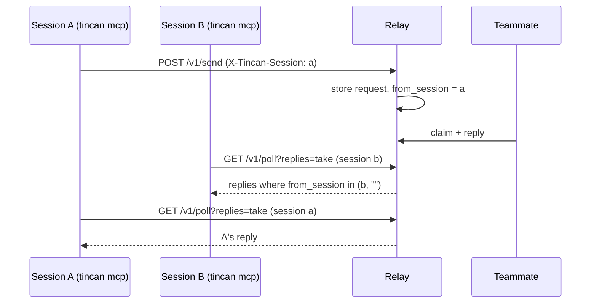

# Session-Scoped Replies - Plan

## Goal Capsule

- Objective: treat each Claude Code session as its own thread. When several sessions share one agent name, a reply goes back only to the session that asked, its notice fires only there, and a new ask is filed under the sending session's own work, never under another session's. The safety checks stay as strict as today.
- Means: an optional `X-Tincan-Session` header that names the client session. The relay records it on requests and claims and filters unseen replies and the open-claim lookup by it (KTD1-KTD4).
- Authority: Product Contract requirements win on behavior. `docs/trust-model.md` and the backward-compatibility rule in `CONTRIBUTING.md` win over any KTD.
- Stop conditions: stop and report if session scoping would need a change to identity, admin checks, or wake message content, or if an existing `/v1` field or route has to change shape.
- Execution profile: Go only (store, relay, policy, client, MCP, CLI) plus docs. No extension change.
- Finishing: one PR, Conventional Commit title `feat(relay): deliver replies to the session that asked`.

---

## Product Contract

### Summary

A client can name its session with the `X-Tincan-Session` header. `tincan mcp` sends one by default, made fresh for each MCP server process, so each Claude Code session gets its own with no setup. `TINCAN_SESSION` overrides it, for the MCP server and the CLI alike. The relay stores the sender's session on each request. A caller that names a session gets only the replies to its own requests and to requests that carry no session. A caller that names no session gets every reply, as today. The relay also records which session claimed a request, so an ask with no parent is filed under the sending session's own open claim and never under another session's. The cycle and hop checks still see every open claim of the agent, as today, so a session label can never loosen them.

### Problem Frame

People run several Claude Code sessions on one machine, one per project, and all of them use the machine's one tincan agent. The relay keys unseen replies by agent (`internal/store/replies.go`, `UnseenReplies`). Session A asks a teammate something. Session B calls `check_inbox` first, takes A's reply, and acks it. A never sees the answer, and B acts on context it does not have. The `--channel` notice also tells every session about every reply.

The parent link has the same flaw. `policy.parent` falls back to `store.OpenClaim(agent)` when a sender names no parent. If session A holds one claim and session B sends an unrelated ask, B's ask joins A's chain. That inherits A's hop count and chain, and can reject B's ask as a cycle when B asks the agent that sent A's request.

Today the only fix is one agent per session (`tincan invite` plus `TINCAN_CONFIG`). It needs an admin device and an invite per session, and it fills the roster with short-lived agents.

### Requirements

Replies

- R1. A poll, peek, or `check_inbox` that names a session returns and counts only unseen replies to requests sent from that session or sent with no session.
- R2. A caller that names no session sees every unseen reply for the agent, exactly as today.
- R3. `get` by request id is unchanged. Any session of the agent can read any of its replies by id.

Chains

- R4. An ask that names no parent is linked (parent and trace) only to an open claim made from the same session, or to a claim made with no session.
- R5. An explicit parent id keeps today's checks and is not scoped by session.
- R10. A session label never loosens a safety check. When the agent-wide rule of today would link the ask to a claim but R4 does not, the ask still inherits that claim's chain and hop for the cycle check, the hop limit, and allowlists. Only the parent and trace links, which decide where the ask is filed in trace and search, follow the session.

Client

- R6. `tincan mcp` names a session by default, unique per process. `TINCAN_SESSION`, when set, names the session for any tincan command.
- R7. Other CLI commands (`inbox`, `wait`, `listen`, `get`) name no session unless `TINCAN_SESSION` is set.

Compatibility and trust

- R8. An old client works unchanged against a new relay, and a new client works against an old relay (the header is ignored; behavior is today's).
- R9. The session is a routing label inside one agent, not an identity. It never affects who the sender is, admin checks, rate limits, or wake message content.

### Acceptance Examples

- AE1. Covers R1. Sessions A and B of one agent each send an ask and both are answered. A poll from A with `replies=take` returns only A's reply. A later poll from B returns only B's.
- AE2. Covers R1, R8. A request stored before the upgrade, or sent by an old client, has no session. Its reply appears for every session and for sessionless callers.
- AE3. Covers R2. With A's and B's replies waiting, `tincan inbox` with no `TINCAN_SESSION` returns both.
- AE4. Covers R4, R10. Session A claims an ask from grokbot. Session B sends a new ask to muse with no parent. B's ask gets a new trace (it does not show in A's trace or in grokbot's search) but keeps A's chain and hop, so a B ask to grokbot is still rejected as a cycle, as today.
- AE6. Covers R1. Session A's MCP process exits before A's reply arrives. The reply never appears in another session's poll or notice. `tincan get <id>` and a sessionless `tincan inbox` can still read it.
- AE5. Covers R1. A peek from session B while only A's reply waits reports zero waiting replies, so the `--channel` notice does not fire in B.

### Scope Boundaries

- New requests from teammates still go to the agent, and any session may claim them. The owner judged per-session addressing not worth building: tasks rarely start on another machine and target this one.
- Wake stays per agent. The waker counts every unseen reply for the agent, so a sleeping agent still wakes for any of them.
- No fallback that hands an untaken reply to other sessions after a timeout (owner decision: replies to a closed session stay with it). A sessionless `tincan inbox` or `get <id>` can still take it.
- Roster, `agents` output, trace, and search do not show sessions.

#### Deferred to Follow-Up Work

- Addressing a request to one session (for example `claude-macbook/site`), which needs a naming and wake design.
- Showing the session on `trace` rows.

---

## Planning Contract

### Key Technical Decisions

- KTD1. **Header, not a body field.** Send and poll both need the session, and poll is a GET. One header set in `client.Relay.headers` reaches every call, and old relays ignore unknown headers (R8). This matches how `X-Tincan-Version` and `X-Tincan-Features` already travel.
- KTD2. **Sessionless rows are visible to every session.** Requests with an empty session stay visible to session callers (AE2). Otherwise an upgrade would hide replies to requests sent before it, and an old client sharing the agent with a new one would lose replies.
- KTD3. **Session id made per MCP process, not per client.** A Claude Code session runs one `tincan mcp` process, so the process is the session. Generating the id in `client.NewRelayFor` would give every one-shot CLI call its own session and hide replies from `tincan inbox`, which breaks R2 and R7. The MCP command sets it after `connect()`.
- KTD4. **Claim session recorded on the claim, not inferred.** The session that claims a request may differ from any session that sent something. Record it when the request becomes claimed and scope `OpenClaim` by the sender's session. An empty session on either side matches only an empty session on the other, so a sessionless sender keeps today's behavior when every claim is sessionless.
- KTD5. **Reject malformed session values.** The relay returns 400 for a value over 64 bytes or outside `[A-Za-z0-9._-]`. Ignoring it silently would make a bad `TINCAN_SESSION` look like the scoping does not work.
- KTD7. **File by session, check by agent.** `policy.parent` resolves two things: the link (parent id, trace) from the session-scoped claim lookup, and the guard (chain, hop) from today's agent-wide lookup. When they differ, the request keeps the guard's chain and hop but gets a fresh trace and no parent id. Search and trace visibility key on `trace_id` (`internal/store/search.go`), so the ask is filed in its own thread, while the cycle check, hop limit, and allowlists read `Chain` and see exactly what they see today. A teammate may see the other session's chain names in "Chain so far"; names only, no bodies, as today.
- KTD6. **Wake and roster stay per agent.** `Server.UnseenReplies`, `UnseenReplyIDs`, and `AgentsWithUnseenReplies` keep their agent-wide meaning. Wake carries counts only (greptile P0), and waking the agent is still right when any of its sessions has a reply.

### High-Level Technical Design

Visibility rule for unseen replies (directional):

| Caller session | Request `from_session` | Visible |
|---|---|---|
| none | any | yes |
| `a` | `a` | yes |
| `a` | empty | yes |
| `a` | `b` | no |

### Assumptions

- Claude Code starts one `tincan mcp` process per session. A session that restarts its MCP server gets a new id and loses sight of replies to asks it sent earlier. Those replies stay reachable through `get <id>` and sessionless `inbox`.

---

## Implementation Units

### U1. Store: session on requests and claims

**Goal:** persist the sender's session and the claimer's session, and filter unseen-reply reads and the open-claim lookup by session.
**Requirements:** R1, R2, R4, R8
**Dependencies:** none
**Files:** `internal/store/store.go`, `internal/store/replies.go`, `internal/envelope/envelope.go`, `internal/store/replies_test.go`, `internal/store/store_test.go`
**Approach:** add `from_session` and `claim_session` text columns (NOT NULL DEFAULT '') with migrations in the `migrateUrgent` style. Add a relay-only `FromSession` field to `envelope.Request` (`json:"-"`, like `WasHeld`) that `Enqueue` writes. Give `UnseenReplies` and `CountUnseenReplies` a session argument: empty means all rows; otherwise `from_session IN (?, '')`. Extend the requests index if the plan for the query needs it. The claim update writes `claim_session`. `OpenClaim` takes the sender's session and matches `claim_session = ?`.
**Patterns to follow:** `migrateUrgent`, `migrateReplySeen`, existing `requests_from_seen` index.
**Test scenarios:**
- Covers AE1. Two requests from one agent with sessions `a` and `b`, both replied: `UnseenReplies(agent, "a")` returns only `a`'s; `CountUnseenReplies(agent, "b")` is 1.
- Covers AE2. A request with empty session is returned for session `a`, session `b`, and no session.
- Session empty returns both `a` and `b` replies.
- Migration on a database created without the new columns keeps existing rows and reads them as sessionless.
- Covers AE4. `OpenClaim(agent, "b")` returns nothing when the only claim was made in session `a`; `OpenClaim(agent, "a")` returns it; `OpenClaim(agent, "")` returns it only when its claim session is empty.
**Verification:** store tests pass; a pre-migration database fixture opens cleanly.

### U2. Relay: read the header on send, claim, and poll

**Goal:** the relay reads and validates `X-Tincan-Session` and passes it to the store on send, claim (including claims made through poll), poll, and peek.
**Requirements:** R1, R2, R3, R8, R9
**Dependencies:** U1
**Files:** `internal/relay/server.go`, `internal/client/relay.go` (header constant), `internal/relay/session_replies_test.go`, `internal/relay/replies_test.go`
**Approach:** one helper reads and validates the header (KTD5); identity stays in `Server.agent`. `handleSend` sets `FromSession`. `handlePoll` passes the session into `unseenReplies` and the peek count. Claim paths pass it to the store. `handleAckReplies`, `handleGet`, and the wake-facing `Server` methods stay agent-wide (R3, KTD6).
**Execution note:** start from the failing `TestSessionPollReturnsOnlyItsOwnReplies` already on the branch.
**Test scenarios:**
- Covers AE1. The existing repro test passes, extended so B's next poll returns only B's reply after A acks.
- Covers AE5. Peek with session `b` and only `a`'s reply waiting reports zero replies.
- Covers AE3. A poll with no header returns both replies.
- A header of 65 bytes, or one containing `/`, gets 400 on send and on poll.
- `GET /v1/requests/{id}` from session `b` still returns `a`'s reply.
- Wake counts (`Server.UnseenReplies`) still count both sessions' replies.
- Covers AE6. A reply to a session that never polls again does not show in any other session's poll or peek, and does not re-wake the agent on every wake tick (confirm the waker's existing debounce covers it; if not, stop and report).
**Verification:** relay tests pass with and without the header.

### U3. Policy: file the implicit parent by session, check by agent

**Goal:** an ask with no parent is filed under only the same session's open claim, and the safety checks are unchanged.
**Requirements:** R4, R5, R10
**Dependencies:** U1, U2
**Files:** `internal/policy/policy.go`, `internal/policy/policy_test.go`, `internal/relay/session_replies_test.go`
**Approach:** set `FromSession` on the request before `Prepare` runs. In `parent`, keep today's agent-wide `OpenClaim(agent)` as the guard and add a session-scoped lookup as the link (KTD7). The explicit-parent branch is unchanged. Claims made by `tincan inbox` or `listen` have an empty claim session and match every session, so those chains are never broken.
**Test scenarios:**
- Covers AE4. Session A claims grokbot's ask; session B asks muse with no parent; the send gets a new trace and no parent id, and its chain and hop match today's.
- Covers AE4. Same setup, session B asks grokbot: rejected as a cycle, as today.
- Same setup, B uses a made-up session label: identical result (the label cannot loosen the checks).
- Session A's claim came from a sessionless `tincan inbox`; session A asks with no parent: linked as today.
- Session A, same setup, asks a third agent with no parent: the ask continues A's chain (hop 2, same trace).
- With no sessions anywhere, today's single-open-claim behavior holds.
- An explicit parent from another session's claim is accepted as today.
**Verification:** policy and relay tests pass; no change to cycle and hop-limit tests.

### U4. Client and MCP: send the session

**Goal:** `tincan mcp` sends a per-process session id; `TINCAN_SESSION` sets it for any command.
**Requirements:** R6, R7, R8
**Dependencies:** U2 (for end-to-end tests; the client change itself is independent)
**Files:** `internal/client/relay.go`, `internal/client/attachments.go` (confirm it uses the shared headers), `internal/cli/agent.go`, `internal/cli/mcp.go`, `internal/client/relay_test.go`, `internal/mcpserver/server_test.go`
**Approach:** `client.Relay` gains a session field and a setter, and `headers()` sends it when set. `connect()` applies `TINCAN_SESSION` when present. The `mcp` command, when the variable is unset, sets a random id after `connect()`, so the server, `check_inbox`, and the `--channel` watcher (`pushWaiting`) all share it.
**Test scenarios:**
- With a session set, every request the client sends, attachment uploads included, carries the header; without one, none does.
- `TINCAN_SESSION=x` makes `connect()` return a relay with session `x`.
- Covers AE1, end to end. Two MCP sessions against `testrelay` under one agent each `ask` muse; muse replies to both; `check_inbox` in each returns only its own reply.
- Covers AE5. The channel watcher in session B does not announce while only A's reply waits.
- Two `tincan mcp` starts produce different ids.
**Verification:** client, CLI, and MCP tests pass; `make lint` is clean.

### U5. Docs

**Goal:** users and agents know sessions exist and what they do and do not promise.
**Requirements:** R6, R9
**Dependencies:** U2, U4
**Files:** `docs/protocol.md`, `docs/trust-model.md`, `docs/adapters/claude-code.md`, `README.md`, `site/agents.txt`
**Approach:** in `docs/protocol.md`, document the header next to the version and features headers and add the session rule to the "Replies the asker has not seen" section. In `docs/trust-model.md`, add one guarantee: a session is a routing label, any client of the agent can still read every reply by id or by a sessionless poll. In the Claude Code adapter doc, explain several sessions on one machine and `TINCAN_SESSION`. Add a short line to the README and `site/agents.txt` only if they describe multi-session setup today.
**Test expectation:** none -- documentation only.
**Verification:** docs match the shipped behavior and the PR description lists them.

---

## Verification Contract

| Gate | Command | Proves |
|---|---|---|
| Unit and integration tests | `make test` | U1-U4, no regressions, race-free |
| Vet | `make vet` | build hygiene |
| Lint | `make lint` | repo lint rules |
| Compatibility | the tests in U2 that send no header | R2, R8 |
| Live (owner approval required) | relay on this branch, two Claude Code sessions on one agent each ask a teammate | AE1 against real agents |

The live gate needs a relay running this branch. The owner's mesh relay is shared, so run it against a local relay or get the owner's approval before upgrading the shared one.

## Definition of Done

- Every acceptance example has a passing test.
- `make test`, `make vet`, and `make lint` pass.
- Docs in U5 updated in the same PR.
- PR title `feat(relay): deliver replies to the session that asked`; the description states the problem, the change, the compatibility story, and how it was tested, per `CONTRIBUTING.md`.
- No version bump, release notes, or artifacts.

## Sources

- `internal/store/replies.go` `UnseenReplies` and `internal/store/store.go` `OpenClaim`: the agent-wide keys at the root of both problems.
- `internal/policy/policy.go` `parent`: the implicit-parent fallback.
- `internal/cli/mcp.go` `pushWaiting`: the channel watcher that shares the MCP process's client.
- `greptile.json`: wire compatibility (P1), wake counts only (P0), identity only through `Server.agent` (P0), tests and docs required (P2).
- PR #145: an optional helper that routes Desktop conversations; it does not touch relay routing.
