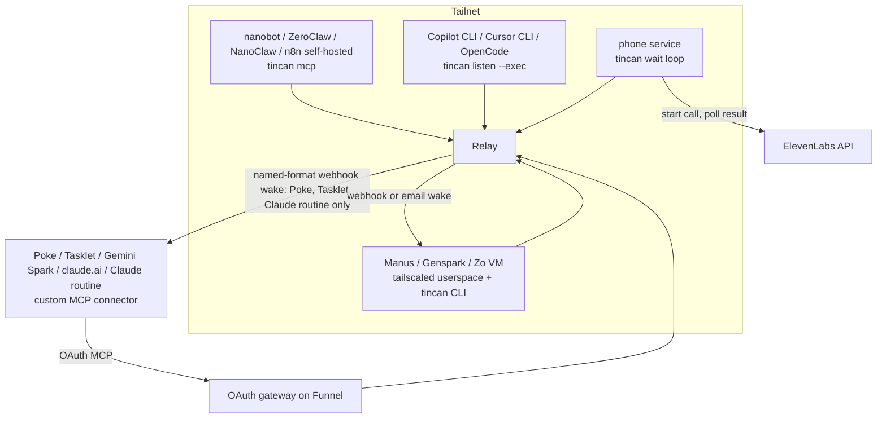
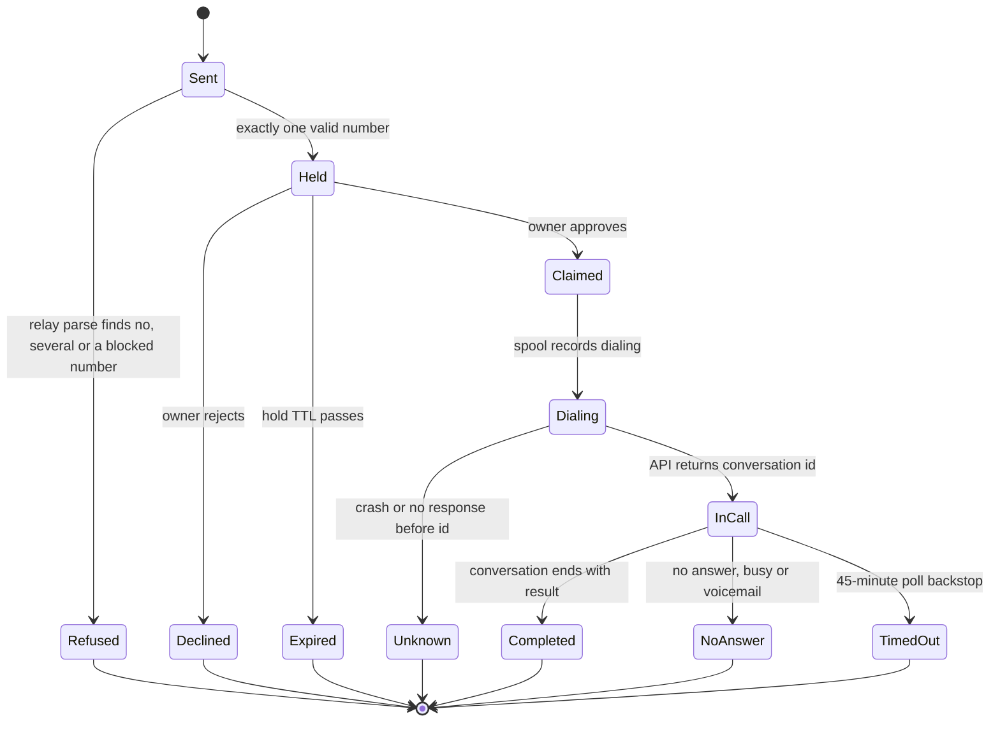

# Personal Agents Wave 1 - Plan

## Goal Capsule

- **Objective:** The personal agents people actually run in late 2026 (Poke, Tasklet, Manus, Genspark Claw, Zo, Gemini Spark, claude.ai and Claude routines, the self-hosted OpenClaw alternatives, n8n) can join an owner's Tincan team, ask teammates for help, and, where their platform allows it, be woken to answer. Any teammate can ask a phone agent to place a real call and get the outcome back. Copilot CLI, Cursor and OpenCode join as coding teammates, and the history agent can search their chats. None of this widens what the public gateway accepts or weakens the trust model.
- **Means:** Reuse the joins Tincan already has. Agents with a shell join the tailnet like Instinct and Hark (KTD1). Agents without one join through the existing OAuth gateway (KTD2). Webhook wakes gain named formats and a daily cap (KTD4, KTD5). The phone agent is a new service modeled on `internal/notes` that polls for the call result (KTD7). A live check gates every platform before its adapter is built (KTD3).
- **Authority:** Product Contract requirements win on behavior. KTDs win on mechanism. Units override neither. `docs/trust-model.md` is not loosened except where a unit says so explicitly and updates it in the same PR.
- **Stop conditions:** Stop and ask the owner if:
  - any unit would add a static token, API key, or other non-OAuth login to the gateway;
  - any webhook wake body would carry request or reply text, or `include_requests` would be turned on for a hosted agent;
  - the phone agent would dial without an owner approval;
  - a platform's live check fails in a way that would need a new wake method or listener to fix.
- **Execution profile:** Go relay, CLI and services, POSIX wake scripts, docs. Base every branch on `origin/main`, not the local checkout's older branch. Land in several PRs by phase (see Phased Delivery). Each PR updates its own docs per `CONTRIBUTING.md`.
- **Who finishes:** An implementing agent lands U2 to U13. U1 needs the owner's accounts (Poke, Tasklet, Manus Cloud Computer, Genspark Cloud Computer, Zo, Gemini AI Ultra or Pro, Claude, ElevenLabs, and a Twilio account or SIP trunk with a voice number imported into ElevenLabs), so the owner and the implementing agent run it together. The owner places the first real phone call after U11 ships.

---

## Product Contract

### Summary

Add a first wave of personal-agent teammates to Agent Tincan, plus a phone-call teammate and a smaller coding-agent track. Every platform passes a live check first. Hosted agents with their own Linux VM (Manus, Genspark Claw, Zo) join the tailnet as real nodes. Hosted agents without a shell (Poke, Tasklet, Gemini Spark, claude.ai, Claude routines) join through the existing OAuth gateway. Poke, Tasklet and Claude routines are woken through new named webhook formats. claude.ai and Gemini Spark cannot be woken. Self-hosted runtimes (nanobot, ZeroClaw, NanoClaw, n8n) get setup recipes. A new `phone` service agent turns an approved ask into an ElevenLabs outbound call and replies with the outcome. Copilot CLI, Cursor CLI and OpenCode get command-wake scripts, and the history agent learns to read Cursor, Copilot CLI, Gemini CLI and OpenCode chats.

### Problem Frame

Tincan already covers most of the personal agents with the strongest community signal this quarter: Dots, Grok Bot, OpenClaw, Hermes, Muse and Instinct. The next tier cannot join at all. Poke has passed 100M messages a quarter on iMessage. Manus is now owned by Meta and sells an always-on Cloud Computer. Gemini Spark is rolling out to Gemini's paid tiers. The self-hosted OpenClaw alternatives each have 30k to 50k stars. Most of these accept a custom MCP server and have a webhook, email address or schedule that could wake them. In this quarter's threads, the most common complaints were that always-on agents lock you into one vendor and that they cannot hand work to each other. Tincan is the neutral layer that fixes both, so every major platform it leaves out weakens that pitch.

Separately, Tincan's flagship example ("Grok Bot asks Muse to call the restaurant") depends on one sandbox agent driving a browser. Voice-agent APIs now place calls directly and report the result, so a dedicated phone teammate makes that example dependable. On the coding side, GitHub Copilot and Cursor are the second and fourth most-used coding agents of 2026, and OpenCode is the top open-source one. None of them can join, and their chats are invisible to the history agent.

### Requirements

Live verification

- R1. No platform's adapter is built until a live check has confirmed its join path, its wake path and its ask path, and the result is recorded in that platform's adapter doc.
- R2. A platform that passes only part of the check ships only the parts that passed. Its doc says what it cannot do. A platform that fails its join check moves to the next wave with the blocker recorded.

Joining

- R3. A hosted agent with its own Linux VM joins the tailnet as a tagged, non-ephemeral node limited by ACL to the relay, using the existing invite flow. No gateway credential is involved.
- R4. A hosted agent without a shell joins through the existing OAuth gateway. The gateway gains no new login method.
- R5. Connecting a gateway agent never takes over a name already held by a real tailnet node unless the admin passes an explicit replace flag.
- R6. Each new platform has a runtime name, an adapter doc and, unless it is ask-only under R10, a stock good-at line. The README agent and platform tables and `site/agents.txt` list it.

Waking

- R7. An agent whose platform has an inbound webhook trigger is woken through it. The wake body and headers follow a named format per platform. The wake still carries only counts and the fixed instruction, never request or reply text.
- R8. An agent's wake entry can cap wakes per day as well as per hour. When the cap stops a wake, the asker is told when the next wake can go out.
- R9. When an ask goes to an agent that cannot be woken, the send response tells the asker the agent acts only when a person talks to it.
- R10. An agent that can ask but whose platform cannot answer unattended (expected: Gemini Spark) is documented as ask-only and has no good-at line that invites asks.

Phone teammate

- R11. A teammate can ask the `phone` agent to call a number for a stated goal and gets back the outcome: a summary, what was agreed, and a short transcript excerpt.
- R12. Every ask to the phone agent is held for owner approval by default. The approval preview shows the normalized number and the goal, not just the raw ask.
- R13. The phone agent places at most one call per request. A redelivered or requeued request never dials again.
- R14. The phone agent dials only valid E.164 numbers. It refuses emergency, premium-rate and, unless the owner allowlists them, international numbers.
- R15. Every call opens by saying it is an AI assistant calling on the owner's behalf.
- R16. Every phone outcome (completed, no answer, busy, voicemail, failed, timed out, approval expired) ends the request with a defined reply status. None leaves the asker waiting.

Coding agents and history

- R17. Copilot CLI, Cursor CLI and OpenCode join as command-woken agents through `tincan listen --exec`. Each wake run sees only the Tincan MCP server and runs with the narrowest tool approval its CLI offers.
- R18. The history agent can answer questions about chats in Cursor (CLI and IDE), Copilot CLI, Gemini CLI and OpenCode, excluding sessions started by Tincan's own wake runs.
- R19. New history source names never collide with existing ones. A question that names "Gemini" or "Copilot" without saying CLI still goes to the web source.

### Acceptance Examples

- AE1. Covers R2. Given Manus joins the tailnet and can run `tincan ask`, but its webhook trigger rejects the relay's request. Then Manus ships as an agent that checks its inbox on a schedule, and its doc says the webhook wake did not work.
- AE2. Covers R8. Given `claude-routine` has `max_per_day: 5` and has been woken 5 times today. When a sixth ask arrives, no wake is sent, and the asker's send response says the next wake can go out after midnight UTC.
- AE3. Covers R12, R14. Given an ask "call 911 and report a leak". The send is refused before any hold, with the reason "emergency numbers are not dialed". Given an ask "call +1 206 555 0100 to book a table for 4 at 7pm". The hold preview reads "Call +12065550100: book a table for 4 at 7pm".
- AE4. Covers R13, R16. Given the phone service dialed, saved the conversation id, then crashed. When the request is redelivered, the service resumes polling that conversation and does not dial. If the dial call itself returned no answer and its outcome is unknown, the service replies failed and does not retry.
- AE5. Covers R16. Given the owner leaves a phone ask unapproved past the hold TTL. Then the request ends as expired, the asker gets a relay note saying "not approved in time", and can ask someone else.
- AE6. Covers R5. Given `claude-code` is a real tailnet agent. When the admin runs `tincan connect claude-code`, the command refuses and names the replace flag. `tincan connect claude-ai` succeeds.
- AE7. Covers R19. Given the history agent is asked "what did I ask Gemini about rent last week". It searches the `gemini` web source. Given "what did I ask gemini cli about the Makefile". It searches the `gemini-cli` source.

### Success Criteria

- Each platform in the Summary either has a shipped adapter with a recorded live check, or a recorded blocker on the next-wave list.
- From Grok Bot, an owner can say "ask phone to call the restaurant and book 7pm", approve the hold, and get the booking outcome back in the same thread.
- `tincan doctor` reports clean on a relay with every wave 1 agent configured.

### Scope Boundaries

- Static-token or API-key login on the gateway. Considered for Manus and Genspark, and rejected because both now offer a VM that can join the tailnet. The Sesame plan's boundary stands. Revisit only if a platform the owner wants has no VM and no OAuth.
- A public listener for ElevenLabs post-call webhooks. Polling covers it (KTD7).
- A generic webhook body or header template. Named formats only (KTD4).
- Request text in email wakes for hosted agents. The existing `include_requests` email option stays off for Manus, Genspark and Zo, because each email can start a billed task in a third party's inbox.
- Automatic retry of failed calls. A retry is a new ask and a new approval.
- Calling-hours rules for the phone agent. The owner's approval is the gate.
- Meta AI on WhatsApp (WhatsApp's Business API has banned general-purpose AI bots since January 2026), Siri and Alexa+ (no usable hook found), extension-driven DeepSeek (account risk), and Claude Cowork (folded into Claude chat on 2026-09-16).

### Deferred to Follow-Up Work

Ranked next wave, each needing its own short plan:

1. Lindy (webhook trigger plus a Lindy Mail inbox per agent; custom MCP unverified).
2. Perplexity Computer (custom MCP plus Automations; wake only through a Gmail trigger or schedule).
3. Duckbill as a human-call service teammate through its MCP server.
4. Letta Code (custom channel plugin running `tincan wait`) and Agent Zero.
5. Goose, Cline, Amp and Kiro as command-woken CLIs.
6. Cloud coding agents: Claude Managed Agents, Cursor Cloud Agents, Jules, Devin.
7. An A2A bridge on the relay, with OpenClaw's A2A channel as its first peer.
8. Returning MCP Tasks handles from `ask` (MCP 2026-07-28 Tasks extension).
9. An iMessage channel for approvals and needs_input answers from the owner's phone.
10. Abacus Claw, Town and Tab once they publish a hook.
11. A neutral alias for `--chatgpt-gateway` (carried from the Sesame plan).

### Sources

- Repo research dossier from origin/main 98cc6eb, summarized inline where it shaped a decision.
- Gateway: `internal/gateway/gateway.go`, `internal/gateway/oauth.go`, `internal/identity/virtual.go`.
- Webhook wake: `internal/wake/wake.go`. Service pattern: `internal/notes/`. Default holds: `internal/policy/policy.go`.
- Prior plans: `docs/plans/2026-10-06-1559-feat-sesame-adapter-plan.md` (gateway non-goals), `docs/plans/2026-10-06-1025-feat-hark-scheduled-teammate-plan.md` (startup restore in a wiped workspace), `docs/plans/2026-09-29-1740-feat-dot-teammate-plan.md` (hold by kind).
- External: [Manus custom MCP](https://manus.im/docs/integrations/custom-mcp), [Manus automations](https://manus.im/docs/automations), [Manus Cloud Computer launch](https://aihola.com/article/manus-cloud-computer-launch), [Genspark Claw help](https://www.genspark.ai/helpcenter/genspark-claw), [Tasklet guide](https://tasklet.ai/learn/guide), [Poke SDK](https://pypi.org/project/poke/), [Gemini custom apps](https://support.google.com/gemini/answer/17209137), [Claude Code routines](https://www.gigazine.net/gsc_news/en/20260416-claude-code-routine), [Cowork folded into Claude](https://venturebeat.com/technology/anthropic-is-killing-off-cowork-and-folding-it-into-claude-launching-claude-docs-and-claude-slides), [ElevenLabs outbound call](https://elevenlabs.io/docs/eleven-agents/api-reference/twilio/outbound-call.md), [nanobot concepts](https://raw.githubusercontent.com/HKUDS/nanobot/main/docs/concepts.md), [Stack Overflow 2026 agents](https://survey.stackoverflow.co/2026/ai/data/ai-code-agent), [WhatsApp AI bot ban](https://respond.io/blog/whatsapp-general-purpose-chatbots-ban), [Cursor -p MCP issue](https://forum.cursor.com/t/cursor-agent-p-mode-does-not-inject-mcp-server-tools-into-agent-context/155275).

---

## Planning Contract

### Key Technical Decisions

- KTD1. **Shell-capable hosted agents join the tailnet, not the gateway.** Manus Cloud Computer, Genspark Cloud Computer and Zo run Tailscale (userspace mode when there is no TUN device or root) and the `tincan` CLI, reusing the Hark startup-restore script. Tailscale identifies the caller, so the trust model is unchanged. (session-settled: user-directed — chosen over static-token gateway login: the owner pointed out these platforms can install Tailscale.)
- KTD2. **The gateway stays OAuth-only.** Dynamic client registration already exists (`internal/gateway/gateway.go` `/register`). Wave 1 changes only the metadata gaps the live check proves matter: standard OAuth client authentication methods besides `none` (such as `client_secret_post` for a client that registers a secret), `scopes_supported`, and the RFC 8707 `resource` parameter. These are OAuth client-authentication variants inside the existing login, not a new login method under R4. (session-settled: user-approved — chosen over adding header tokens for Manus and Genspark: KTD1 makes them unnecessary.)
- KTD3. **A live gate runs before any adapter is built, and partial passes ship partially.** It is recorded per platform in a "Verified" section of `docs/adapters/<x>.md`: date, join result, wake request that worked (format, headers by name, body fields), ask result, confirmation prompts and caps seen, verdict. (session-settled: user-approved — chosen over building from docs alone: several hooks are documented only by third parties.)
- KTD4. **New webhook wakes are named formats, not templates.** Each platform that needs a different body or header gets a `format` value beside `openclaw` in `internal/wake/wake.go`, with its own checker and body branch. Every new header value joins the `webhookSecrets` redaction list. A free-form template could interpolate request text, which the code review rules forbid.
- KTD5. **`max_per_day` joins `max_per_hour` on wake targets.** Both budgets apply, and fallback paths share them. A capped wake is reported on the ask's send response with the time the budget resets. Needed because Claude routines allow 5 or 15 runs a day and the relay re-wakes every grace period. Two rules keep the cap honest:
  - A target with `max_per_day` gets no `--wake-grace` follow-ups for a request it was already woken for. Only new requests and new replies wake it, so one silent run cannot spend the day's budget.
  - The daily count survives a relay restart. It is seeded at startup from the relay's recorded wakes for the current UTC day.
- KTD6. **`tincan connect` refuses a name bound to a real node.** `BindVirtual` currently rewrites any agent's node to `virtual:<name>`. Connect gains a `--replace` flag and refuses otherwise. Gateway agents use product-scoped names (`claude-ai`, `claude-routine`, `poke`, `tasklet`, `gemini-spark`).
- KTD7. **The phone agent polls for call results and never listens.** The service runs on the owner's Mac with no inbound port. It starts the call through the ElevenLabs outbound-call API, then polls the conversation until it ends. A webhook receiver would be a second public listener, which the code review rules flag. The call itself is capped by the ElevenLabs agent's maximum conversation duration, which setup requires to be under 45 minutes. A 45-minute poll limit is the backstop, and its timed-out reply says the call may still have been running.
- KTD8. **Exactly-once dialing through a spool written before the dial returns.** The phone service records "dialing" for the request id before calling the API, then the conversation id once it returns. On redelivery, a record with a conversation id resumes polling. A record stuck at "dialing" with no id replies failed ("call outcome unknown") rather than redial. Same shape as `internal/notes/spool.go`.
- KTD9. **The relay parses the phone number at send time, before the hold.** `phone` joins `holdByDefault` beside council and dot-web. Holds are applied in the relay at send time, before any agent can claim, so number checks must run there too. For a target of kind `phone`, policy preparation runs a deterministic parser (no model) that requires exactly one phone number in the ask, normalizes it to E.164 and applies R14:
  - A refused, missing or ambiguous number rejects the send with the reason. Nothing is held.
  - A valid ask is held with the preview "Call <E.164>: <goal>" and the normalized number stored on the request.
  - The phone service dials only that stored, approved number. It never re-extracts a number from the body or takes one from a needs_input answer, since answers are not re-held.
- KTD10. **The ElevenLabs key lives in a 0600 file checked at load,** like `wake.json`. It is never in a plist, log, audit detail or reply. Doctor reports presence only. `docs/trust-model.md` and the `greptile.json` outbound-host rule name `api.elevenlabs.io` in the same PR.
- KTD11. **History sources get CLI-suffixed names, and Cursor's databases are copied before reading.** Sources are `cursor-cli`, `cursor-ide`, `copilot-cli`, `gemini-cli`, `opencode`. The extractor defaults bare "Gemini" and "Copilot" to the web sources. Cursor and OpenCode SQLite stores are copied with their `-wal` and `-shm` files into a 0700 temp dir and opened from the copy, because the apps hold the WAL and `immutable=1` misses recent chats. `modernc.org/sqlite` is already a dependency.
- KTD12. **New command-wake scripts reuse `examples/lib/tincan-wake-lib.sh` and record wake sessions in the `<name>.wake-sessions` format** the Grok CLI reader already skips, so U13's readers can exclude wake runs.
- KTD13. **Cursor CLI relies on the shared lib's run timeout for hangs.** Its headless mode has open reports of MCP tools missing in `-p` and of runs hanging. `examples/lib/tincan-wake-lib.sh` already kills a run after `TINCAN_WAKE_TIMEOUT` and backs off, so no Cursor-specific watchdog is built. The Cursor script passes the MCP-approval flags the live check confirms and documents a shorter `TINCAN_WAKE_TIMEOUT` if U1 shows hangs.

### High-Level Technical Design

How each wave 1 agent reaches the relay:

Phone request lifecycle (states recorded in the spool, KTD8):

Outcome per terminal state: Refused is a rejected send. Expired keeps the existing expired status and sends the asker a relay note. Completed is answered. Every other state is failed with a one-line reason.

### Assumptions

- Manus and Genspark Cloud Computers allow installing and running Tailscale in userspace mode. Unverified; U1 decides.
- Poke, Tasklet and Claude routine webhooks accept the generic `{source, message, text}` body or need only a fixed field rename. U1 records the exact shape.
- Gemini Spark needs manual confirmation for every write tool, which makes it ask-only (R10). U1 confirms.
- claude.ai allows two custom connectors to the same gateway host, so chat and routines can be separate agents. If not, they share one `claude-ai` identity and the doc says so.

### Phased Delivery

| Phase | Units | Ships as |
|---|---|---|
| A. Live gate | U1 | Verified sections in adapter docs (no code) |
| B. Shared plumbing | U2, U3, U4 | One PR |
| C. Hosted agents | U5, U6, U7, U8 | One PR per unit, only for platforms that passed U1 |
| D. Self-hosted recipes | U9 | One PR |
| E. Phone teammate | U10, U11 | One PR |
| F. Coding track | U12, U13 | Two PRs |

Each phase needs only its own platforms' U1 records, not the whole gate. Phases E and F can start alongside phase B. Phase D starts alongside B too, except a ZeroClaw recipe that needs a named webhook format waits for U3.

### System-Wide Impact

- Trust model: new tailnet nodes on third-party VMs (R3), a new outbound host for the phone agent (KTD10), a new default-held kind (KTD9), new local files read by history (KTD11). Each is documented in `docs/trust-model.md` in the PR that adds it.
- Wake budget: `max_per_day` changes how often the relay wakes some agents and what senders see (KTD5).
- Identity: the connect guard (KTD6) changes `tincan connect` behavior for every admin.
- Code review rules: `greptile.json` gains the ElevenLabs host and the new history read paths.

### Risks and Dependencies

| Risk | Mitigation |
|---|---|
| A vendor changes or removes a hook after the gate passes | Adapter docs carry the verified date. Doctor's wake-result reporting already shows a failing webhook. |
| A hosted VM gets wiped and its tagged node is not re-admitted | Recipe keeps tailscaled state in the VM's persistent folder. The doc says a full wipe needs a new invite. |
| Phone calls carry US telemarketing-law (TCPA) and state disclosure exposure | Default hold (KTD9), number limits (R14), AI disclosure (R15). The doc tells owners to call only numbers they would call themselves. |
| ElevenLabs and Twilio both bill per minute | The ElevenLabs agent's maximum call duration (KTD7) and one call per request (R13). |
| Hosted agents start a billed vendor task on every wake | Their example `wake.json` entries set `max_per_day` and a `max_per_hour` below the default 12 (U5, U8). |
| Vendor-hosted agents receive whatever teammates answer them, including history results | Each new adapter doc carries the vendor-egress paragraph the Sesame doc has and points to the history and web-agent allowlists. |
| Cursor CLI headless bugs | The shared lib's run timeout (KTD13). If the gate shows MCP tools still missing, Cursor CLI moves to the next wave and only its history reader ships. |
| Gemini Spark's paid-tier and US-only rollout | Ask-only scope (R10). The doc states the account requirement. |

---

## Implementation Units

| U-ID | Title | Key files | Depends on |
|---|---|---|---|
| U1 | Live verification gate | `docs/adapters/*.md` Verified sections | none |
| U2 | Connect name guard | `internal/identity/virtual.go`, `internal/cli/connect.go` | none |
| U3 | Webhook named formats and daily cap | `internal/wake/wake.go` | U1 (webhook platforms) |
| U4 | Gateway compatibility and no-wake notice | `internal/gateway/gateway.go`, `internal/relay/server.go` | U1 (gateway platforms) |
| U5 | Poke and Tasklet adapters | `internal/onboard/onboard.go`, `docs/adapters/poke.md` | U2, U3, U4 |
| U6 | claude.ai connector and Claude routine | `internal/onboard/onboard.go`, `docs/adapters/claude-ai.md` | U2, U3, U4 |
| U7 | Gemini Spark (ask-only) | `internal/onboard/onboard.go`, `docs/adapters/gemini-spark.md` | U2, U4 |
| U8 | Hosted VM agents: Manus, Genspark Claw, Zo | `examples/grokbot/tincan-up.sh`, `docs/adapters/cloud-vm.md` | U1, U3 |
| U9 | Self-hosted recipes | `docs/adapters/self-hosted.md`, `examples/n8n/` | U1 (self-hosted platforms), U3 if ZeroClaw needs a format |
| U10 | Phone service core | `internal/phone/` | U1 (ElevenLabs step) |
| U11 | Phone onboarding, hold and docs | `internal/policy/policy.go`, `internal/cli/phone.go` | U10 |
| U12 | Copilot CLI, Cursor CLI, OpenCode wake | `examples/copilot-cli/`, `examples/cursor-cli/`, `examples/opencode/` | U1 (coding CLIs) |
| U13 | History readers for new CLIs | `internal/history/cursor.go` and siblings | U12 (wake-session records only) |

### U1. Live verification gate

**Goal:** Decide, per platform, which join, wake and ask paths actually work, before any adapter code is written.

**Requirements:** R1, R2, R10.

**Dependencies:** None.

**Files:** `docs/adapters/poke.md`, `docs/adapters/tasklet.md`, `docs/adapters/claude-ai.md`, `docs/adapters/gemini-spark.md`, `docs/adapters/cloud-vm.md`, `docs/adapters/phone.md`, `docs/adapters/self-hosted.md`, `docs/adapters/copilot-cli.md`, `docs/adapters/cursor-cli.md`, `docs/adapters/opencode.md` (Verified sections only).

**Approach:**
1. Gateway agents (Poke, Tasklet, Gemini Spark, claude.ai, Claude routine, n8n Cloud): connect each to a test relay's gateway with `tincan connect`, call `ask` and `check_inbox`, and note any OAuth error that points at KTD2's metadata gaps.
2. Webhook wakes (Poke, Tasklet, Manus, Claude routine): send a hand-built request with the generic body to each trigger. Record the body fields and header names that started a turn.
3. Hosted VMs (Manus, Genspark, Zo): install Tailscale in userspace mode, join with a tagged invite, run `tincan ask`, then restart or hibernate the VM and record what survives. Record which of webhook, email (from an AgentMail address) and schedule starts a turn.
4. Gemini Spark: check whether claim and reply need manual confirmation in a scheduled run.
5. ElevenLabs: import a Twilio number (or SIP trunk) into ElevenLabs, place one call to the owner's own phone through the outbound-call API, and poll the conversation to completion. Record the status values seen for answered, unanswered and voicemail, how soon an unanswered call shows as ended, and where the agent's maximum call duration and audio retention are set.
6. Self-hosted runtimes (nanobot, ZeroClaw, NanoClaw, self-hosted n8n): join, wake and ask once on the current release of each.
7. Coding CLIs: confirm each headless command, MCP config path and narrowest approval flag. Check whether Cursor `-p` loads MCP tools on the current release.
8. Fill each doc's Verified section per KTD3 and mark the verdict: full, partial (list what passed), or next wave.

**Execution note:** This is a manual, account-backed check. Nothing here is committed as code. Record secrets by name only.

**Test expectation:** none -- this unit produces verified facts that later units' tests encode.

**Verification:** Every platform in the Summary has a Verified section with a verdict, and the Deferred list gains any platform that failed.

### U2. Connect name guard

**Goal:** `tincan connect` cannot silently take over a real tailnet agent's name.

**Requirements:** R5.

**Dependencies:** None.

**Files:** `internal/identity/virtual.go`, `internal/gateway/gateway.go` (`Connector.Connect`), `internal/cli/connect.go`, `internal/relay/server.go` (`handleConnect`), `internal/identity/virtual_test.go`, `internal/cli/connect_test.go`, `docs/trust-model.md`.

**Approach:** Connect checks whether the name is bound to a non-virtual node and refuses unless the request carries `replace`. The CLI adds `--replace` and passes it through the admin API as an optional field. Per KTD6.

**Patterns to follow:** existing admin flags on `tincan remove` and the optional-field rule in `CONTRIBUTING.md`.

**Test scenarios:**
- Connecting a new name binds it and returns a login code.
- Connecting a name held by a real tailnet node fails with an error naming `--replace`, and the node binding is unchanged. Covers AE6.
- Connecting with `--replace` rebinds the name to a virtual node and keeps its stored kind.
- Reconnecting a name that is already virtual succeeds without `--replace`.
- An older CLI that omits the field gets the refusal, not a silent takeover.

**Verification:** The scenarios pass, and the trust model's gateway section states the guard.

### U3. Webhook named formats and daily cap

**Goal:** The relay can wake each webhook platform that passed U1 with the body and headers it expects, within a daily budget.

**Requirements:** R7, R8.

**Dependencies:** U1.

**Files:** `internal/wake/wake.go`, `internal/wake/formats_test.go` (new), `internal/wake/wake_test.go`, `internal/wake/fallback_test.go`, `internal/relay/server.go` (send response), `internal/relay/server_test.go`, `README.md` (Wake methods table).

**Approach:**
1. Add one `format` constant per platform whose U1 record needs more than the generic body (expected candidates: `poke`, `tasklet`, `manus`, `claude-routine`). Each gets a checker beside `checkOpenClaw` and a branch in the body and send code. Per KTD4.
2. Add any new header values to `webhookSecrets`.
3. Add `max_per_day` to `Target`, validated at load and enforced in `allow` alongside `max_per_hour`. Per KTD5.
4. Record relay-side wakes for capped targets in the store beside the existing wakes table, and seed the day's count from it when the Waker starts.
5. Skip `--wake-grace` follow-ups for a capped target when the queued work was already covered by an earlier wake.
6. When a wake is skipped for the daily cap, the ask's send response gains an optional field with the reset time. The existing unanswered-wake notice uses the same text.

**Patterns to follow:** `internal/wake/openclaw_test.go` for payload and auth tests. `checkOpenClaw` refusing a token in the query string.

**Test scenarios:**
- Each new format sends exactly the body fields and header names from its U1 record, with a fixed count message.
- A wake body never contains request text, even when `include_requests` is set on a webhook target.
- Each new header value is redacted from a response body that echoes it.
- An unknown format value is rejected at load with the format name in the error.
- `max_per_day: 5` allows 5 wakes, skips the 6th, and allows wakes again after the UTC day rolls over. Covers AE2.
- A fallback path's wakes count against the same daily budget.
- A Waker rebuilt after 5 recorded wakes today still skips the 6th.
- A capped agent that stays silent after a wake is not re-woken for the same queued request. A new request still wakes it while budget remains.
- The send response for an ask to a capped agent includes the reset time, and an older client ignores the field.

**Verification:** Scenarios pass. The README wake table lists the new formats and `max_per_day`.

### U4. Gateway compatibility and no-wake notice

**Goal:** The gateway works with every OAuth client U1 tested, and askers learn when their target cannot be woken.

**Requirements:** R4, R9.

**Dependencies:** U1.

**Files:** `internal/gateway/gateway.go`, `internal/gateway/oauth.go`, `internal/gateway/gateway_test.go`, `internal/relay/server.go` (`recipientTarget` and send response), `internal/relay/server_test.go`, `docs/trust-model.md`.

**Approach:**
1. Change only the metadata and token-endpoint behavior that U1 showed a client needs (KTD2). Likely candidates: advertise `scopes_supported`, accept and ignore a matching RFC 8707 `resource` parameter, accept `client_secret_post` for clients that send a secret at registration.
2. For targets that cannot be woken, the send response gains an optional field saying the agent acts only when a person talks to it. Decide this from the target's stored kind having default wake `none` (chatgpt, claude-ai, gemini-spark), not from a missing `wake.json` entry. Agent-side kinds (wait, channel, command) often have no entry and must not get the notice.

**Execution note:** Start with a failing gateway test that replays the exact request a client sent during U1.

**Patterns to follow:** `TestTwoGatewayAgentsKeepSeparateTokens` and the DCR tests in `internal/gateway/gateway_test.go`.

**Test scenarios:**
- A registration and token exchange replayed from each U1 client succeeds.
- A `resource` parameter naming another host is rejected.
- If confidential clients are accepted: a wrong secret fails, and the secret is stored only as a hash.
- Metadata still lists only routes the gateway serves.
- An ask to a `claude-ai` agent returns the acts-only-when-a-person-talks-to-it field. An ask to a webhook agent does not.
- An ask to a `codex` agent with no `wake.json` entry does not return the field.

**Verification:** Scenarios pass. `TestAgentAPINotExposed` still passes.

### U5. Poke and Tasklet adapters

**Goal:** Poke and Tasklet can ask teammates through the gateway and are woken by their webhook triggers.

**Requirements:** R4, R6, R7.

**Dependencies:** U2, U3, U4.

**Files:** `internal/onboard/onboard.go`, `internal/onboard/templates/agent.tmpl`, `internal/cli/connect.go`, `internal/onboard/poke_test.go` (new), `internal/onboard/tasklet_test.go` (new), `docs/adapters/poke.md`, `docs/adapters/tasklet.md`, `README.md`, `site/agents.txt`, `docs/trust-model.md`.

**Approach:**
1. Add `KindPoke` and `KindTasklet` with runtime names, `defaultWake` webhook, stock good-at lines, and membership in `isGatewayKind`.
2. Add template branches for a gateway agent woken by webhook, since `expectOnline` and the gateway text assume schedule or none today.
3. Add `connectSteps` and the adapter docs: connect, register the connector in the product, create the trigger, add the `wake.json` entry with the format from U3. The example entry sets `max_per_day` and a `max_per_hour` below 12, and the doc says each wake starts a billed run.
4. State how replies reach the asker: the relay's existing reply re-wake uses the same webhook.
5. Each doc carries the vendor-egress paragraph from `docs/adapters/sesame.md` and points to the history and web-agent allowlists.

**Patterns to follow:** Sesame's commit 69bc98c and `internal/onboard/sesame_test.go`.

**Test scenarios:**
- `tincan onboard` for each kind renders gateway setup steps with no shell-only lines.
- The rendered steps name the webhook trigger, not a schedule.
- The rendered `wake.json` example includes `max_per_day`.
- `RuntimeKind("poke")` and `RuntimeKind("tasklet")` return the new kinds.
- `connect` prints the product-specific steps for each kind.
- The roster shows the stock good-at line for each kind.

**Verification:** Scenarios pass, and each doc's Verified section matches the shipped wake format.

### U6. claude.ai connector and Claude routine

**Goal:** claude.ai chat can ask teammates while the owner is chatting, and a Claude routine can be woken to answer within its daily cap.

**Requirements:** R4, R6, R7, R8, R9.

**Dependencies:** U2, U3, U4.

**Files:** `internal/onboard/onboard.go`, `internal/onboard/templates/agent.tmpl`, `internal/cli/connect.go`, `internal/onboard/claude_test.go` (new), `docs/adapters/claude-ai.md`, `README.md`, `site/agents.txt`.

**Approach:**
1. Add `KindClaudeAI` (wake `none`) and `KindClaudeRoutine` (wake webhook with the `claude-routine` format and a documented `max_per_day` of 5 or 15).
2. If U1 showed claude.ai allows only one connector per host, ship a single `claude-ai` identity and document that routines and chat share its inbox.
3. The routine's good-at line names its daily cap so askers pick it for occasional work.

**Patterns to follow:** the ChatGPT connector kind and U5.

**Test scenarios:**
- Onboarding `claude-ai` renders gateway steps with no wake section.
- Onboarding `claude-routine` renders the routine trigger steps and a `wake.json` example with `max_per_day`.
- `claude-ai`, `claude-web` and `claude-code` stay distinct kinds and runtime names.

**Verification:** Scenarios pass.

### U7. Gemini Spark (ask-only)

**Goal:** Gemini Spark users can ask Tincan teammates from Spark, with accurate docs about what Spark cannot do.

**Requirements:** R4, R6, R10.

**Dependencies:** U2, U4.

**Files:** `internal/onboard/onboard.go`, `internal/onboard/templates/agent.tmpl`, `internal/cli/connect.go`, `internal/onboard/gemini_spark_test.go` (new), `docs/adapters/gemini-spark.md`, `README.md`, `site/agents.txt`.

**Approach:** Add `KindGeminiSpark` as a gateway kind with wake `none` and no stock good-at line. If U1 showed Spark can claim and reply unattended, switch to a schedule wake and add a good-at line instead.

**Test scenarios:**
- Onboarding renders connect steps and states that Spark does not answer teammates.
- The roster shows no good-at line for `gemini-spark`.
- An ask to `gemini-spark` returns the no-wake notice from U4.

**Verification:** Scenarios pass. The doc names the account tier and region requirements.

### U8. Hosted VM agents: Manus, Genspark Claw, Zo

**Goal:** Each hosted VM that passed U1 joins the tailnet as a tagged node, survives a restart, and is woken by the path U1 confirmed.

**Requirements:** R3, R6, R7.

**Dependencies:** U1, U3.

**Files:** `examples/grokbot/tincan-up.sh`, `internal/wake/tincanup_script_test.go` (or the existing script test for `tincan-up.sh`), `internal/onboard/onboard.go` (runtime names only), `docs/adapters/cloud-vm.md`, `README.md`, `site/agents.txt`, `docs/trust-model.md`.

**Approach:**
1. Map runtime names `manus`, `genspark`, `zo` to existing kinds by wake path: `vm-webhook` for a confirmed webhook, `e2b-email` for confirmed email, `scheduled` otherwise.
2. Extend `tincan-up.sh` only where U1 showed a VM differs from Hark: base folder, userspace flag, and keeping tailscaled state in the persistent folder.
3. One adapter doc with a section per platform: tagged non-ephemeral invite, relay-only ACL, startup restore, wake setup, the paid-tier requirement, and the vendor-egress paragraph from U5.
4. Webhook and email wake examples set `max_per_day` and a `max_per_hour` below 12, since each wake starts a billed task. `include_requests` stays off (Scope Boundaries).

**Execution note:** Add script-test coverage for the new flags before changing Hark's default behavior.

**Patterns to follow:** `docs/plans/2026-10-06-1025-feat-hark-scheduled-teammate-plan.md` and `docs/adapters/hark.md`.

**Test scenarios:**
- With no new flags, `tincan-up.sh` behaves exactly as Hark's tests expect.
- With a persistent state folder set, the script reuses saved tailscaled state and does not ask for a new key.
- With userspace mode set, the script starts tailscaled without a TUN device.
- `RuntimeKind` maps each runtime name to the kind its doc names.

**Verification:** Scenarios pass. Each platform's doc section matches its U1 record.

### U9. Self-hosted recipes

**Goal:** nanobot, ZeroClaw, NanoClaw and n8n users can join with a documented recipe and an included example.

**Requirements:** R6, R7.

**Dependencies:** U1 (self-hosted platforms). U3 only if ZeroClaw's webhook needs a named format.

**Files:** `internal/onboard/onboard.go` (runtime names), `internal/onboard/templates/recipes.tmpl`, `internal/onboard/onboard_test.go`, `docs/adapters/self-hosted.md`, `examples/n8n/tincan-agent.json`, `examples/nanoclaw/add-tincan/SKILL.md`, `README.md`, `site/agents.txt`.

**Approach:**
1. nanobot and PicoClaw-style runtimes: `tincan mcp` plus a heartbeat line that checks the inbox. Kind `scheduled`.
2. ZeroClaw: `tincan mcp` plus webhook wake. Kind `generic` with webhook, or a named format if its webhook needs one.
3. NanoClaw: a channel skill that runs `tincan wait` in the container. Kind `proxy-sandbox` style wait.
4. n8n: an importable workflow with a Webhook trigger, an AI Agent node and the MCP Client Tool pointed at `tincan mcp` on a tailnet host. The Webhook node uses Header Auth with a credential the owner creates and puts in `wake.json`. The agent's prompt is fixed (check the inbox and handle claimed requests) and never includes the webhook body, so a leaked webhook URL cannot inject instructions. n8n Cloud users use the gateway instead, only if U1's n8n Cloud check passed.

**Execution note:** Mostly docs and examples. Prove each recipe with a live run, not unit tests.

**Test scenarios:**
- `RuntimeKind` maps `nanobot`, `zeroclaw`, `nanoclaw` and `n8n` to the kinds their recipes name.
- The recipes template renders a section for each.
- `examples/n8n/tincan-agent.json` parses as JSON and contains no credentials.
- The n8n workflow's agent prompt does not reference the webhook body, and its Webhook node requires header auth.

**Verification:** Each recipe matches its U1 record, and the doc records the version used.

### U10. Phone service core

**Goal:** A `phone` service agent turns an approved ask into one ElevenLabs call and replies with its outcome.

**Requirements:** R11, R13, R14, R15, R16.

**Dependencies:** U1 (ElevenLabs step).

**Files:** `internal/phonenum/phonenum.go` (deterministic parser and R14 rules, no dependencies on relay packages), `internal/phonenum/phonenum_test.go`, `internal/phone/serve.go`, `internal/phone/spool.go`, `internal/phone/elevenlabs.go`, `internal/phone/serve_test.go`, `internal/phone/spool_test.go`, `internal/phone/elevenlabs_test.go`.

**Approach:**
1. Build `internal/phonenum`: find exactly one phone number in free text, normalize to E.164, and apply R14 with an optional international allowlist. U11 calls it from the relay at send time (KTD9).
2. Copy the `internal/notes` service shape for `internal/phone`: config, `Run` via `history.RunPolling`, `handleSafely` with presence, panic recovery, allowlist check before acting.
3. Read the normalized number stored on the approved request and use the request body as the goal. Re-check the number with `internal/phonenum` as a backstop. Never take a number or new goal from a needs_input answer.
4. Write the spool record, start the call with the configured ElevenLabs agent id and the goal as a dynamic variable, and save the conversation id (KTD8). The agent's first message carries the R15 disclosure and says the call is recorded and transcribed.
5. Poll the conversation, posting progress every 5 minutes to renew the claim lease, until it ends. Stop at the 45-minute backstop (KTD7).
6. Map the ended conversation to the outcomes in the High-Level Technical Design using the status values U1 recorded. A call that never reaches an in-progress state within a few minutes replies failed "no answer". Answered replies carry a summary, agreed details and a transcript excerpt capped at a few hundred words.

**Execution note:** Implement `internal/phonenum` and the spool test-first. They are what keeps a real call from happening twice or to the wrong place.

**Patterns to follow:** `internal/notes/serve.go`, `internal/notes/spool.go`, `internal/notes/serve_test.go` on `internal/testrelay`.

**Test scenarios:**
- An approved request with a stored number places one call to exactly that number and replies answered with the summary and excerpt.
- `phonenum` rejects "call 911", a premium-rate number, and an international number unless allowlisted. Covers AE3.
- `phonenum` rejects text with no number and text with two different numbers.
- `phonenum` normalizes "+1 206 555 0100" and "(206) 555-0100" with a US default to "+12065550100".
- A request body containing a second number never changes the dialed number.
- A needs_input answer containing a number never triggers a start-call request.
- After a crash with a saved conversation id, redelivery resumes polling and makes no second start-call request. Covers AE4.
- After a crash between "dialing" and the API response, redelivery replies failed "call outcome unknown" and makes no start-call request. Covers AE4.
- A no-answer, busy or voicemail result replies failed with that reason.
- A call still running at the 45-minute backstop replies failed "timed out, the call may still have been running" and stops polling.
- A conversation that never leaves its initial state replies failed "no answer" within minutes, not at the backstop.
- Progress is posted at least every 5 minutes during a long call.
- The API key never appears in logs, progress notes or replies, including on API errors.
- The fake ElevenLabs server receives the disclosure text in the first message field.

**Verification:** Scenarios pass under `go test -race`.

### U11. Phone onboarding, hold and docs

**Goal:** The phone agent installs like other services, is held for approval by default, and its trust surface is documented.

**Requirements:** R6, R12, R16.

**Dependencies:** U10.

**Files:** `internal/onboard/onboard.go`, `internal/onboard/templates/agent.tmpl`, `internal/policy/policy.go`, `internal/policy/phone_test.go` (new), `internal/relay/server.go` (held preview, sweep note), `internal/relay/wakenotice.go`, `internal/relay/server_test.go`, `internal/phone/service.go`, `internal/cli/phone.go`, `internal/cli/root.go`, `internal/cli/phone_test.go`, `docs/adapters/phone.md`, `docs/trust-model.md`, `greptile.json`, `README.md`, `site/agents.txt`.

**Approach:**
1. Add `KindPhone` to `Kinds`, `runtimeNames`, `defaultWake` (`wait`), `stockGoodAt` ("Places real phone calls for you; held for your approval by default") and `isService`.
2. Add `KindPhone` to `holdByDefault`. In policy preparation, for a `phone` target, run `internal/phonenum` on the ask before the hold check (KTD9). Reject a refused, missing or ambiguous number with a 4xx and its reason. Store the normalized number on the request, and build the held preview as "Call <E.164>: <goal>" with the full goal.
3. When a held request expires, the relay's sweep sends the asker a note "not approved in time" (AE5). Today the sweep skips held transitions, so this is a relay change. The request keeps the existing expired status, which council and dot-web holds share.
4. Add `tincan phone serve`, `install` and `doctor`, with the key file per KTD10. Doctor warns when the ElevenLabs agent's maximum call duration is unset or 45 minutes or more, if U1 found it readable through the API.
5. Document setup: Twilio or SIP number imported into ElevenLabs, ElevenLabs agent with a maximum call duration under 45 minutes and audio retention turned off, key file, how to rotate the key, number allowlist, the disclosure, where the owner approves holds (`tincan approve` on an admin device, with approval notify pointed at the agent they use), and the legal note from Risks. The trust model notes that transcripts stay in the owner's ElevenLabs account until deleted.

**Patterns to follow:** `internal/notes/service.go`, `internal/cli/notes.go`, `internal/policy/dot_test.go`.

**Test scenarios:**
- An ask to a `phone` agent with no approval.json entry is held. An explicit release entry lets it through.
- A send to a `phone` agent asking to call 911 is rejected with the emergency-number reason and nothing is held. Covers AE3.
- A send with two numbers is rejected as ambiguous.
- The hold preview shows the normalized number and the full goal. Covers AE3.
- A held request that passes its TTL ends as expired and the asker gets the "not approved in time" note. Covers AE5.
- Sends to other kinds are unaffected by the phone parser.
- `phone doctor` reports a missing key file, a key file readable by others, and a present key, without printing the key.
- `phone install` writes a launchd plist that contains no key.

**Verification:** Scenarios pass. `docs/trust-model.md` lists phone among default-held kinds and names `api.elevenlabs.io`. `greptile.json` allows that host.

### U12. Copilot CLI, Cursor CLI, OpenCode wake

**Goal:** Each coding CLI that passed U1 can be asked work and answers through a headless wake run.

**Requirements:** R6, R17.

**Dependencies:** U1.

**Files:** `examples/copilot-cli/copilot-wake.sh`, `examples/cursor-cli/cursor-wake.sh`, `examples/opencode/opencode-wake.sh`, `examples/gemini-cli/gemini-wake.sh`, `examples/lib/tincan-wake-lib.sh`, `internal/wake/geminiwake_script_test.go`, `internal/wake/copilotwake_script_test.go`, `internal/wake/cursorwake_script_test.go`, `internal/wake/opencodewake_script_test.go`, `internal/cli/doctor_configs.go`, `internal/cli/doctor_configs_test.go`, `internal/onboard/onboard.go`, `internal/onboard/onboard_test.go`, `docs/adapters/copilot-cli.md`, `docs/adapters/cursor-cli.md`, `docs/adapters/opencode.md`, `docs/trust-model.md`, `README.md`, `site/agents.txt`.

**Approach:**
1. One wake script per CLI on the shared lib. Each pins a wake home with only the Tincan MCP server and passes the narrowest approval U1 found. Copilot CLI uses a `--allow-tool` allowlist for the Tincan tools, not `--allow-all-tools`.
2. Record wake sessions per KTD12. Extend the existing `examples/gemini-cli/gemini-wake.sh` the same way, so U13's Gemini CLI reader can skip its runs.
3. Cursor's script relies on the lib's run timeout (KTD13).
4. Add each kind to `freshSession`, `defaultWake` (`command`) and `stockGoodAt`. Add the CLIs' MCP config paths to `mcpConfigFiles`.
5. Document each CLI's approval posture in the trust model's command-woken section.

**Patterns to follow:** `examples/grok-cli/grok-wake.sh` and `internal/wake/grokwake_script_test.go`.

**Test scenarios:**
- Each script starts its CLI with the expected headless arguments when `TINCAN_WAITING` is set.
- Each script refuses to run when the wake home lists an MCP server other than agent-tincan.
- Copilot's script never passes `--allow-all-tools`.
- Each script, including the extended `gemini-wake.sh`, appends the run's session id to `<name>.wake-sessions`.
- Doctor finds a Tincan server in each new CLI's MCP config file.

**Verification:** Scenarios pass. A live wake of each CLI answered one ask.

### U13. History readers for new CLIs

**Goal:** The history agent answers questions about Cursor, Copilot CLI, Gemini CLI and OpenCode chats.

**Requirements:** R18, R19.

**Dependencies:** U12 (session record format).

**Files:** `internal/history/history.go`, `internal/history/cursor.go`, `internal/history/copilotcli.go`, `internal/history/geminicli.go`, `internal/history/opencode.go`, matching `_test.go` files, `internal/history/testdata/copilot-cli/`, `internal/history/testdata/gemini-cli/`, `internal/history/serve.go` (`sourceLabel`), `internal/history/extract.go`, `internal/cli/history.go`, `internal/onboard/onboard.go` (history good-at line), `docs/adapters/history.md`, `docs/trust-model.md`, `greptile.json`.

**Approach:**
1. Add sources per KTD11. Each reader follows the Grok CLI reader: honor the CLI's home override, return the no-history result when the store is absent, exclude wake and scratch sessions.
2. Cursor and OpenCode readers copy SQLite stores before opening (KTD11). Cursor fixtures are built in `t.TempDir()` at test time rather than committed.
3. Gemini CLI reads the `~/.gemini/tmp` session files only. Antigravity's protobuf store stays out (unpublished schema).
4. The extractor's source list gains the new names, with bare "Gemini" and "Copilot" kept on the web sources (R19).

**Execution note:** Confirm each store's current layout on a real install before writing fixtures. The layouts here come from inspection, not published schemas.

**Patterns to follow:** `internal/history/grokcli.go`, `internal/history/grokcli_test.go`.

**Test scenarios:**
- Each reader lists the newest sessions first within the window.
- Sessions listed in `<name>.wake-sessions` are excluded.
- A missing store returns the no-history result, not an error.
- The Cursor reader returns a chat written only to the WAL file of a fixture database.
- The Cursor reader leaves no temp copy behind after a read, including on error.
- "What did I ask Gemini about rent" routes to `gemini`. "What did I ask gemini cli about the Makefile" routes to `gemini-cli`. Covers AE7.
- `tincan history --source cursor-ide` is accepted, and an unknown source lists the valid names.

**Verification:** Scenarios pass. The trust model's history section lists the new read paths.

---

## Verification Contract

| Gate | Applies to | Command or check |
|---|---|---|
| Unit and integration tests | U2 to U13 | `make test` (`go test -race ./...`) |
| Vet and lint | All code units | `make vet`, `make lint` |
| Static cross-build | All code units | CI static-build job (CGO off, four targets) |
| Script tests | U8, U12 | the `internal/wake/*_script_test.go` files run under `make test` |
| Live check | U1, U9, U12 | Recorded in each adapter doc's Verified section |
| First real call | U10, U11 | Owner approves one call to their own phone and gets the outcome back in the asking agent's thread |
| PR title | All PRs | Conventional Commits check |

---

## Definition of Done

- Every unit's verification is met, or the unit's platform is on the Deferred list with its U1 blocker.
- Docs ship in the same PR as each change: adapter doc, README tables, `site/agents.txt`, and the trust model where a unit says so.
- No webhook wake body contains request text, `include_requests` is off for every hosted agent, and no log, audit row or reply contains an OAuth token, a webhook secret or the ElevenLabs key.
- No code from abandoned approaches remains in the diff (for example, a format added during U3 for a platform that later failed its gate).
- `tincan doctor` is clean on a relay with every shipped wave 1 agent configured.
