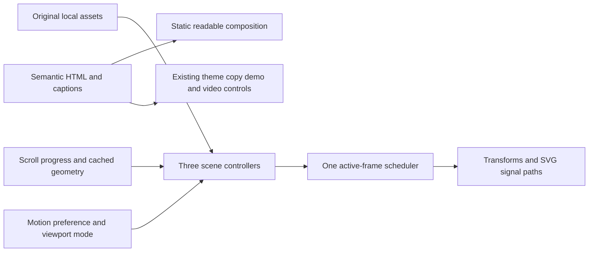
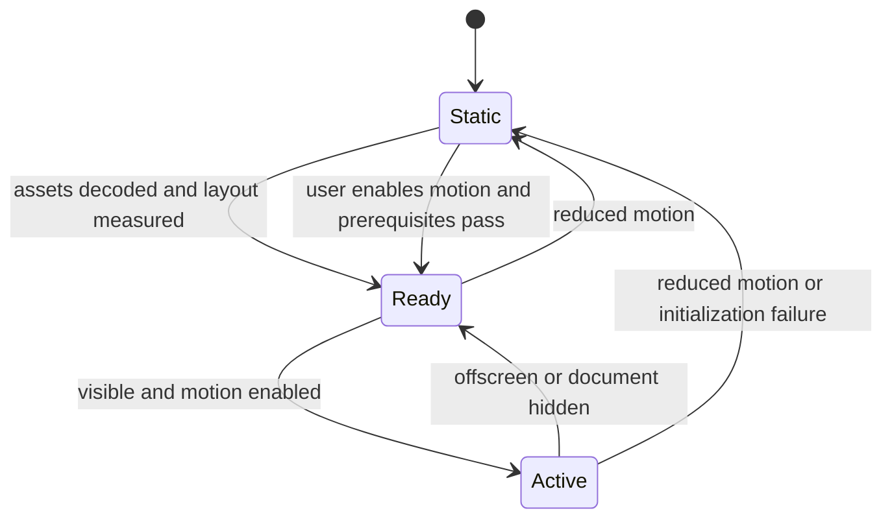

# Tincan cinematic website redesign - Plan

## Goal Capsule

Redesign the complete public agenttincan.com experience into a distinctive, tactile, animated story about agents communicating. Take the reference’s cinematic continuity, playful interactions, and product demonstrations seriously. Give Tincan its own world: brushed metal cans, tensioned strings, electric signals, and miniature devices. Preserve the current product’s facts and setup paths, and make returning to the previous site straightforward.

This artifact authorizes implementation planning. No site code or production deployment changed during planning. Implementation begins in a fresh worktree from current main, produces a reviewable preview, and establishes rollback before production promotion.

## Product Contract

### Summary and problem frame

Tincan lets AI agents ask each other for help through a private relay. The current site contains substantial useful explanations but presents them mainly as conventional sections and cards. The requested redesign should make the connection between agents tangible and memorable while retaining the information people need to install and trust it.

The reference succeeds through an illustrated world that persists across sections. Its motion demonstrates the product and resolves a story. Copying individual effects without that continuity would miss the point.

### Key decisions

- **D1 — Complete cinematic redesign** (session-settled: user-directed — chosen over a cosmetic refresh). Governs R1–R3. The user explicitly requested the whole site and a deep dissection of the reference.
- **D2 — Original visual identity** (session-settled: user-directed — chosen over copying the reference’s colors and assets). Governs R2.
- **D3 — Recoverable release** (session-settled: user-directed — chosen over replacing production without a tested return path). Governs R8.

### Requirements

- **R1 — Whole-site treatment:** redesign the homepage and privacy-page shell, navigation, section transitions, demos, setup presentation, and social preview.
- **R2 — Distinct art direction:** borrow narrative and interaction principles from Studio while creating original compositions, assets, colors, and motion choreography.
- **R3 — Signature motion:** deliver three purposeful cinematic sequences with object continuity, plus responsive details; static screenshots alone cannot satisfy acceptance.
- **R4 — Truth and continuity:** preserve current public capabilities, caveats, install prompts, links, anchor destinations, and machine-readable endpoints.
- **R5 — Usable on every input:** support touch, keyboard, desktop pointers, small screens, zoom, reduced motion, and JavaScript failure with readable content and working navigation.
- **R6 — Fast and controlled:** keep native scrolling, bounded motion work, stable layout, and an immediately available setup route.
- **R7 — Existing behavior:** retain theme preference, copy feedback/fallback, scenario access, GitHub link/count fallback, and access to the launch video.
- **R8 — Rollback:** preserve the previous production deployment and matching source/artifact, validate recovery before launch, and document exact restore steps.

### Boundaries

Public marketing surfaces only. Relay, adapters, app/PWA, extension, authentication, installation commands, and privacy-policy meaning remain outside the redesign. Illustrated demonstrations use fabricated, clearly illustrative examples, never private histories. Do not add telemetry, live agent connections, invented performance statistics, or new product promises.

## Planning Contract

### Repository and deployment grounding

Research date: October 21, 2026. Repository: `mvanhorn/agent-tincan`.

The local checkout is on `feat/teammate-good-at-lines` at `7f653a0`, behind the live site. Fetched `origin/main` was `cce368f6`; current site content describes v0.18.3. Branch from freshly fetched main and compare against production before copying content. Preserve unrelated untracked planning files and existing worktrees.

The site is static HTML/CSS/JavaScript, with no site framework build. Main surfaces are `site/index.html`, `site/styles.css`, `site/script.js`, `site/privacy.html`, and `site/vercel.json`. Existing script owns theme, copy controls, demos, stars, and video sound. The privacy page shares its CSS and script, so every initializer must tolerate absent homepage elements.

Observed production through Vercel CLI:

- Project: `agenttincan`, scope `mvanhorns-projects`.
- Deployment: `dpl_DNdSWXF8pUgkVPjuvg3JL33RBxiF`.
- Immutable URL: `https://agenttincan-8zj96zhhp-mvanhorns-projects.vercel.app`.
- Created October 20, 2026, 17:22:50 PDT; Ready, production.
- Includes `agenttincan.com` and `www.agenttincan.com` aliases.

This is an observed baseline, not a backup already made or a recovery already rehearsed. Refresh it before launch; other releases can supersede it.

### Art direction: Follow the signal

Build a miniature communications workshop, with tactile metal cans as the recurring actors. Strings span isolated devices, tension when connected, carry pulses, and settle after a reply. Close crops reveal metal ridges and cable shadows; wide views explain topology. The recurring signal is the viewer’s orientation device.

Palette starting tokens: ink `#111827`, cool porcelain `#F2F5F7`, silver `#AEBBC7`, cobalt `#275DFF`, vermilion `#F04E37`. Cobalt and vermilion are signal accents, not assumed accessible text colors. Validate final text pairs. Light and dark themes share the same objects with different stage lighting. Keep the existing Space Grotesk/Inter family relationship and use much bolder scale, asymmetry, and editorial spacing.

Use oversized short statements beside detailed, believable UI fragments. Preserve clear body typography. Avoid a repeated grid of identical rounded feature cards. Alternate full-stage scenes, narrow explanatory passages, a horizontal desktop capability bench, and calm setup instructions.

Art must be authored as separate layers: cans, strings, devices, shadows, signal, UI. Do not bake readable text into images. Prefer original SVG/CSS geometry for precision and lightweight reuse, with a small number of original texture/render assets where they improve material quality. The first polished scene establishes the visual standard before the whole page is built.

### Storyboard and motion choreography

| Beat | Composition and motion | What the visitor learns |
|---|---|---|
| Arrival | Giant headline and two beautifully rendered cans on separate device islands. One slack string crosses the fold. A small optional “Send a signal” control produces one ripple. Setup CTA is visible immediately. | These agents need a line to each other. |
| Scene 1: Follow one request | Scroll pulls the camera back from a can to a relay and three devices. The string tensions, a labeled request travels to History, a screenshot result appears, and the same signal returns to the originating phone. | Ask → relay → capable agent → reply, with the relay and required agent awake. |
| Breathing room | Large plain-language explanation; normal scrolling. A compact four-step diagram remains readable independently of the scene. | Why outbound connections solve isolation. |
| Capability bench | Device stations and labeled plugs introduce agent capabilities. Selecting a station opens a concrete example. All supported platforms remain in a semantic directory below. | Which agents can help, and what they can do. |
| Scene 2: Council | One question fans out along three strings. Answers arrive independently; identities fold away for blinded ranking; one verdict card settles into the center. | Independent answers, blind rankings, chairman verdict—not magical consensus. |
| Product details and trust | Alternating editorial sections cover current release, History, teammates, private relay, optional public gateway, approvals, and auditability. Motion is restrained here. | What is available today and where the boundaries are. |
| Scene 3: Return to your phone | Reuse the opening phone and request label. The camera moves toward its screen as the result lands; the surrounding network recedes into the closing composition. End on a readable result and setup CTA. | The network’s practical payoff. |
| Setup and footer | Quiet, high-contrast step layout with the existing A/B/C prompts, copy controls, links, and caveats. | How to start without fighting the spectacle. |

Scene 1 has four explicit scroll poses: disconnected, routed, working, returned. Give each pose readable dwell time; transitions occupy roughly a third of each beat, not its entirety. Start at approximately 240–300vh total desktop track height and tune against actual reading speed. Scene 2 and Scene 3 are shorter, approximately 160–200vh each. These are starting ceilings to tune downward, not reasons to pad the page.

Use a limited motion vocabulary: 160–240ms control feedback, 400–650ms object arrivals, 700–1000ms major handoffs. Scroll camera position derives from progress; a light critically damped settle may smooth motion but must converge and support reversal. Use overlapping departure/arrival, slight anticipation, and bounded overshoot on physical objects. Text stays stable while being read. No autoplay audio; existing video sound remains explicitly controlled.

Capability details open by click, Enter/Space, and touch. Hover can preview the same content but cannot be its only access path. Escape closes and focus returns to the trigger. Do not make the capability bench auto-scroll; a small idle signal pulse is enough.

### Mobile and reduced-motion composition

Below roughly 900px, switch to a purpose-composed vertical sequence with a phone-sized stage and short normal-flow beats. Do not shrink a wide desktop camera world into unreadable miniature UI. Tablet landscape and short laptop viewports also qualify for compact composition when the stage cannot fit.

Reduced motion displays all scene keyframes as a compact storyboard with complete captions; no pinned spacer, camera travel, string oscillation, or continuous idle pulse. A visible motion toggle lets anyone choose this mode. Respect OS preference initially and store only an explicit user override, handling unavailable storage gracefully. Changing mode mid-scroll must leave the current section in view. Decorative scene layers are hidden from assistive technology; meaningful captions and UI examples have one semantic reading order.

### Key technical decisions

- **KTD1 — Keep static architecture:** enhance existing HTML/CSS with self-hosted JavaScript. It fits the deployment and avoids a framework migration unrelated to R1–R8.
- **KTD2 — DOM/SVG scenes:** use layered transforms and SVG string paths, with Web Animations for finite effects and a shared requestAnimationFrame scheduler for active scroll scenes. No WebGL engine or general animation framework is needed for three bounded scenes.
- **KTD3 — Progressive enhancement:** content and navigation work before motion initializes. Add cinematic layout only after required scene assets and dimensions are ready; initialization failure leaves the static composition.
- **KTD4 — Separate motion from existing behavior:** a new `site/motion.js` owns scenes and motion preference; `site/script.js` retains existing UI responsibilities. Keep CSS scene selectors isolated from privacy-page typography.
- **KTD5 — Preserve security policy:** keep script execution self-hosted and avoid unsafe-inline/eval or third-party animation CDNs. Retain the current restrictive CSP; if fonts become local, deliberately add only `self` to font-src.
- **KTD6 — Isolated release and recovery:** use a dedicated branch/worktree, preview deployment, source checkpoint, and preserved production target to satisfy R8. Keep the redesign as a separately revertible commit or contiguous commit group.

Considered and not built: React migration (no needed app state), WebGL physics (DOM layers cover the shots), copied reference artwork/code (R2), live agent demo backend (unneeded trust boundary), new analytics (outside scope), mandatory sound, custom cursor, and global scroll hijacking (harm input predictability). This still leaves substantial original motion work.

### High-Level Technical Design

These sketches define relationships and behavior, not exact implementation signatures.

Component/data flow:

Scene lifecycle:

Mode decisions:

| Condition | Layout | Continuous work |
|---|---|---|
| JavaScript absent or failed | Full semantic static page | None |
| Reduced motion selected | Compact storyboard | None |
| Narrow or short viewport | Vertical scene beats | Only visible finite effects |
| Desktop, normal motion | Sticky stages plus normal sections | Visible active scene only |
| Hidden tab or offscreen scene | Retain current pose | Scheduler sleeps |

On resize, font readiness, orientation change, and restored history position, recalculate geometry outside the animation loop and render the pose for actual scroll position. Never replay from zero simply because the user reloads mid-page. Cancel obsolete finite effects when interaction reverses or a scene is torn down.

### Content migration map

| Current surface | Redesigned destination | Preservation rule |
|---|---|---|
| Hero, why, how | Arrival, request scene, explanatory steps | Retain clear value proposition and always-on relay caveat |
| New in v0.18.3 | Current-release editorial section | Refresh from launch baseline; retain status/watch/failover/pass/phone approval qualifications |
| Council | Council scene plus factual explanation | Preserve approvals, blind ranking, local scorecard, subscription claims |
| Platforms | Capability bench and full directory | Retain every current platform and its distinct limitations |
| History, teammates, four demo scenarios | Worked examples and detail sections | Preserve actual supported behavior; illustrate with invented sample data |
| Trust | Quiet technical section | Keep private-tailnet/default versus optional public-gateway distinctions |
| Get started | A/B/C setup blocks | Preserve exact command/prompt payloads and destinations |
| Privacy | New shell, readable policy | Preserve policy wording and reachable link |
| agents.txt, llms.txt, install.sh | Existing endpoints | Preserve bytes unless an independently necessary correction is identified |

Keep existing IDs including top, main, why, how, new, council, platforms, history, teammates, trust, and get-started, or provide equivalent anchors at the correct semantic destinations. Keep canonical metadata and social links; regenerate og.png to match the new identity.

## Implementation Units

### U1 — Establish the true baseline and recovery package

**Covers:** R4, R8; KTD6. **Depends on:** none.

**Files:** new `docs/site-redesign/baseline.md`, `docs/site-redesign/rollback.md`; isolated worktree, no changes to unrelated checkout files.

Fetch main, create a new feature worktree, record current source SHA and production deployment. Inventory links, anchors, prompts, endpoint hashes, screenshots, and current response headers. Confirm which source produced production using deployment metadata plus site-content comparison; do not assume latest main is the deployed commit. Preserve that source under a dated tag and archive its complete site directory with checksums. If production contains uncommitted differences, capture and reconcile those public artifacts before calling the baseline reproducible.

Document deployment scope/root and production auto-deployment behavior. Establish a preview restore of the old site and check its key routes. This proves the artifact can be redeployed without switching production. Verify production rollback eligibility separately; a preview restoration does not prove Instant Rollback eligibility.

**Verification:** old preview matches baseline screenshots/content; homepage, privacy, install and text endpoints resolve; archive checksums verify. No destructive Git reset or production alias change.

### U2 — Build the original visual system and static page

**Covers:** R1, R2, R4–R6; KTD1, KTD3.

**Files:** `site/index.html`, `site/styles.css`, `site/privacy.html`, new `site/assets/scenes/`, new `docs/site-redesign/art-direction.md`.

Implement semantic page order, tokens, responsive typography, original layered cans/devices, and finished static states for every scene. Record asset source/ownership and export sizes. Build one polished hero and request pose first, then apply its material and lighting rules consistently. Keep setup usable throughout.

**Test scenarios:** JavaScript disabled still exposes full copy and setup; 320px width and 200% zoom have no page-level horizontal overflow; all legacy anchors land below navigation; privacy text remains complete in both themes. Visually inspect hero at desktop and phone sizes before expanding assets.

### U3 — Implement the three signature sequences

**Covers:** R3, R5, R6; KTD2–KTD4. **Depends on:** U2.

**Files:** new `site/motion.js`, scene markup/styles in `site/index.html` and `site/styles.css`.

Implement bounded progress maps for the request, Council, and phone payoff; shared scheduling and cached geometry; finite interactions; compact mobile and reduced-motion states. Reuse the same visual phone/request identity across first and final scenes. Add motion toggle and preference handling.

**Test scenarios:** slowly scroll forward/backward through every boundary; jump directly to Council/setup and reload there; resize while halfway through a scene; toggle motion mid-scene; background and restore the tab; simulate missing scene image and blocked storage. Expect complete readable content, no accumulated transforms, no trapped scroll/focus, and no idle work offscreen. Inspect recorded motion, not only screenshots.

### U4 — Integrate content and existing controls

**Covers:** R1, R4, R5, R7. **Depends on:** U2–U3.

**Files:** `site/index.html`, `site/script.js`, `site/styles.css`, `site/privacy.html`, `site/og.png`.

Migrate the current release narrative and every platform entry. Keep four scenarios available, replacing their visual presentation only. Implement capability disclosures with consistent click/focus/touch behavior. Preserve exact install prompt text, clipboard fallback, theme preference, GitHub link fallback, and video access. Video should be user-playable without forcing a large download during the hero.

**Test scenarios:** keyboard opens/closes each disclosure with returned focus; touch accesses identical details; copy each A/B/C block and compare exact payload; clipboard denial leaves manual selection available; GitHub API failure retains a usable repository link; theme persists between homepage/privacy; video controls work and audio starts only through user action.

### U5 — Verify performance, accessibility, and visual quality

**Covers:** R1–R7. **Depends on:** U3–U4.

**Files:** new `docs/site-redesign/verification.md`; small site-specific browser checks only where the existing toolchain can support them without an unrelated framework migration.

Run the matrix below. Fix issues in owning files. Capture corresponding before/after screenshots and a short motion recording for the preview handoff. Compare against the storyboard and reference principles, not reference pixels. A functional page with generic visuals is unfinished.

**Verification:** all matrix scenarios pass or have an explicit launch-blocking defect; no unresolved major content, interaction, accessibility, or animation regressions. Measure asset transfer and runtime work on a consistent device/profile and report actual numbers.

### U6 — Preview, release, and retain recovery

**Covers:** R8 and complete experience. **Depends on:** U1, U5.

**Files:** update `docs/site-redesign/rollback.md` and `docs/site-redesign/verification.md`; separately revertible site commit(s).

Deploy preview and provide its URL with desktop/mobile recordings and recovery instructions. Recheck production baseline immediately before promotion so unrelated releases are not lost. Keep the exact prior deployment accessible. Promote the reviewed version only after the concrete preview is ready for the user's release decision. After launch, smoke-test both apex and www plus privacy and machine-readable endpoints.

**Recovery:** use the project’s Instant Rollback to the recorded eligible prior deployment. If unavailable, redeploy the preserved site artifact/source with its recorded configuration. Verify domains and endpoint hashes after restoration. Revert only the redesign changes on main so a later release cannot accidentally restore them. Vercel rollback disables automatic domain assignment; intentionally promote the corrected/reverted deployment to restore normal release behavior. Do not use a hard reset that discards unrelated work.

**Verification:** before launch, old artifact redeploys successfully in preview and target eligibility is checked. After any actual rollback, confirm previous appearance, copy behavior, links, headers, and endpoints on production. Record elapsed recovery time; do not promise an unmeasured recovery SLA.

## Verification Contract

| Area | Required evidence |
|---|---|
| Visual and motion | Desktop and phone screenshots plus recordings of all three scenes, including reverse scroll; distinct original art, coherent lighting, stable readable text, purposeful transitions |
| Browsers/input | Current Chrome and Safari desktop; mobile Safari and Android Chrome where available; 320/390/768/1440px and short landscape viewport; keyboard-only and touch |
| Accessibility | Landmarks/headings, visible focus, contrast checks, 200% zoom, no hover-only information, decorative layers excluded from reading order, reduced-motion compact layout, motion pause/control |
| Resilience | JS disabled, storage blocked, missing image, failed stars API, denied clipboard, direct anchors, history restoration, tab visibility and resize |
| Content | Baseline-to-preview comparison of all sections, platforms, caveats, exact setup payloads and destinations; privacy and machine endpoint checks |
| Performance | Target LCP ≤2.5s and CLS ≤0.1 under a documented repeatable mobile lab profile; ≤200KB compressed site JS/CSS combined, ≤1.5MB initial assets excluding user-played video; lazy-load later scene textures; no animation-attributable sustained long tasks over 50ms |
| Security/deployment | No new CSP violations or weakened execution policy; correct text endpoint content types; preview and production route smoke checks |
| Recovery | Baseline SHA/artifact checksums, previous deployment ID, successful old-site preview restore, verified production rollback eligibility and exact instructions |

Performance targets guide implementation; report lab results as lab results, not real-user Core Web Vitals. If hardware/browser testing is unavailable, name that coverage gap and obtain equivalent review before launch. Do not silently mark unrun checks passed.

## Definition of Done

All R1–R8 are demonstrated. The complete site has original finished art and three polished motion sequences, with full content and functional setup on desktop, phone, reduced motion, and static fallback. No reference assets or implementation code were copied. A reviewed preview, clear change summary, verification evidence, and usable rollback instructions exist. Production is promoted only after preview review; if this execution ends at preview, explicitly report that launch remains pending.

## Appendix: Why the reference works

Research combined native-browser desktop interaction with inspection of the reference’s publicly served HTML, CSS, and JavaScript. Desktop hero, zoom-out, phone handoff, village roster, gallery/comparison, and wake-up progression were visually inspected. Mobile composition and exact mechanism values below are source-derived; a physical mobile session was not verified during planning.

| Mechanism | Evidence and effect | Tincan adaptation |
|---|---|---|
| One world over time | Saturday-to-Sunday clock links village, beach, evening, and morning. Locations and characters recur. This makes a long page feel like a journey. | Follow one request and reuse cans/phone, with request-stage labels rather than a copied clock/day narrative. |
| Product reveal through camera | The opening painted scene pulls back into a result inside a chat application. The page becomes proof of what the tool can make. | Pull back from a tactile can into the actual request topology; return with a concrete example result. |
| Consistent camera physics | Sticky story stage maps progress through five chapters; x/y/width/height/cover spring toward targets. Source uses stiffness 110 and damping 24 with clamped delta time. | Use coherent easing and pose interpolation; do not copy constants blindly or add spring drift to readable text. |
| Scale and focus | Phone grows while the surrounding world dims; messages enter with translation and scale. Attention moves before the explanation changes. | Signal leads the eye to destination, then the result settles before the caption advances. |
| Physical-to-interface handoff | Village character sprites approach in perspective; cards fly into a live roster fitted to an illustrated phone with a matrix3d homography. | Agent station → labeled capability → example result. Use simpler DOM perspective unless an authored shot actually needs projective mapping. |
| Interaction rewards curiosity | Gallery drift follows pointer position with a quiet center zone. Focused cards lift, and their overlays reveal specific miniature outputs. Touch/focus behavior is present in source. | Accessible capability disclosures with concrete scenarios and subtle object response. Keep essential detail available without hover. |
| Contrast in pace | Sweeping scenes alternate with comparison, pricing, and FAQ. Calm sections give motion impact and let readers make decisions. | Quiet trust/setup sections between signature scenes. |
| Emotional payoff | Layered poses advance roughly every 190ms during wake-up; phone illumination, pickup, viewpoint change, and completed tasks resolve the overnight-work premise. | Same phone returns with the requested result, closing the communication loop without inventing overnight availability. |
| Art and live UI cooperate | Painted environments carry atmosphere while DOM content supplies legible, interactive product evidence. | Original material assets behind semantic live text, diagrams, and example UI. |
| Mobile is redesigned | Under 899px the reference uses distinct mobile demo composition and chapter segments instead of its desktop lens. | Purpose-built short vertical beats; compact fallback also for reduced motion and short viewports. |

The reference’s real craft is continuity, hierarchy, pacing, and believable detail. Animation volume alone would not reproduce its quality. Its long pinned passages and decorative motion are also reasons to build an easier compact mode for Tincan.

### Sources

- [Studio reference](https://studio.sharenow.today/) — visual direction and interactive inspection.
- [Public reference JavaScript](https://studio.sharenow.today/welcome/app.js?v=1792550463) and [CSS](https://studio.sharenow.today/welcome/style.css?v=1792550463) — mechanism analysis only; no code reuse.
- [Current Tincan site](https://agenttincan.com/) and repository `origin/main` site files — product and deployment baseline.
- [Vercel Instant Rollback](https://vercel.com/docs/instant-rollback) — eligibility, plan-dependent history limits, domain restoration, and subsequent automatic deployment behavior.
- [MDN Web Animations API](https://developer.mozilla.org/en-US/docs/Web/API/Web_Animations_API) and [prefers-reduced-motion](https://developer.mozilla.org/en-US/docs/Web/CSS/Reference/At-rules/@media/prefers-reduced-motion) — implementation primitives and preference handling.
