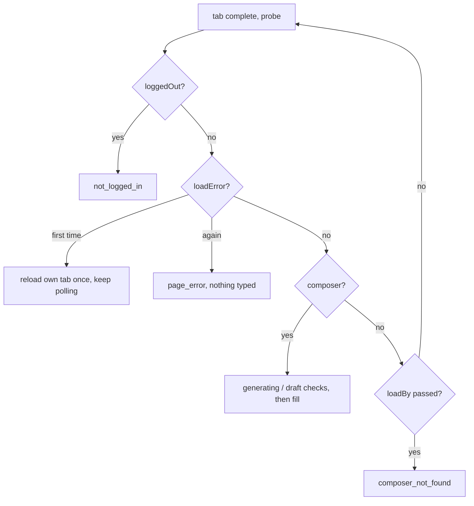

# ChatGPT Web and History Failures - Plan

## Goal Capsule

- Objective: when the owner's ChatGPT-backed teammates (chatgpt-web sends, history reads of ChatGPT) cannot do a job, they fail fast with a reason that names what actually went wrong, and they keep working against the current chatgpt.com page.
- Means: selectors keyed on stable composer and turn signals (KTD1, KTD2), an early check for ChatGPT's own conversation-load error (KTD3), and an honest error when the history request runs out of time (KTD4).
- Authority: this plan, then the user's request of 2026-10-27, then repo conventions in `extension/README.md` and `CONTRIBUTING.md`.
- Stop conditions: stop and report if chatgpt.com shows a login wall or anti-bot check during verification, if a live check needs a credential, or if Chrome would have to be quit or restarted.
- Execution profile: one branch off `origin/main`, Go and extension changes in one PR, live verification against the owner's signed-in Chrome in a new tab only.
- Finish and ship: `ce-work` implements, verifies live, reloads the extension, and opens the PR (no push to main).

---

## Product Contract

### Summary

Update the chatgpt selector table to match the current page, route the image paths through it, fail a send quickly when chatgpt.com shows "Could not load this ChatGPT conversation", and make the history agent report a spent request budget as running out of time instead of blaming Chrome.

### Problem Frame

On 2026-10-27 at 18:39:37Z, claude-code sent one image request to both chatgpt-web (53016d1763c52580f0d2) and history (2faa78aa17b28119ec45) at the same moment.
chatgpt-web failed 52s later with "no message box on the chatgpt.com page (the page may have changed)".
history failed at 18:42:39Z, exactly its 3-minute request budget, with "Chrome did not answer in time".

Live investigation on 2026-10-27 established:

- Text sends work today. `tincan ask chatgpt-web "reply with the word pong"` answered "pong" at 15:45 PDT. A healthy load of the claude-code conversation shows the composer and all turns at 0s.
- The composer is a ProseMirror `div[contenteditable="true"][role="textbox"][aria-label="Ask ChatGPT"]` inside the page's only `form`, with `data-composer-*` attributes on its ancestors. `#prompt-textarea` does not exist. The fallback `form div[contenteditable="true"]` matches it.
- Turns now carry `data-conversation-role="user|assistant"`. `[data-message-author-role]` matches nothing, so `userCount` and `assistantCount` are always 0. Confirmation currently depends on the stop button alone (`generating`).
- With an empty composer, the form holds only "Add files and more", "Select ChatGPT model" and "Start Voice". The send button appears only after text is typed, so the send selectors have not been checked against the live page.
- The half-loaded state becomes terminal, not slow hydration. During a concurrent 100-conversation history search, a fresh load showed title "New chat", zero turns and no composer for over 38s, then ChatGPT's own "Could not load this ChatGPT conversation / Try again" page with no contenteditable at all. Two later loads under the same load were clean, so concurrency raises the odds of this state but does not reliably cause it.
- The history read is a sequential walk: `live.Read` (`internal/history/live.go:153`) lists conversations, then calls `detail` once per candidate. A 50-conversation search took 57s from the CLI and a 100-conversation one took 75s. Full-size image fetches (90s client bound each) and the extractor model step (`DefaultExtractTimeout` 90s) share the same 3-minute budget (`DefaultRequestTimeout`, `internal/history/serve.go:269`).
- When that budget expires, `Client.exchange` (`internal/history/native.go:903`) maps the caller's `context.DeadlineExceeded` to `ErrTimeout`, which prints "Chrome did not answer in time". `ReadFailure` already has an honest "took too long" branch (`serve.go:601`), but it can never run.
- Neither failure left more than one log line (`~/Library/Logs/tincan-chatgpt-web.log`, `tincan-history.log`): no probe snapshot for the send, no per-phase timing for the read. So the cause of the 18:39 send is the most likely explanation from one reproduction, not an observation of that tab. Which phase spent the history budget is also inferred, not measured.
- `pageInputImages` and the image branch of `pageSubmit` hard-code `#prompt-textarea`. Image input is gated off (`IMAGE_INPUT_SITES` is empty, `extension/ops.js:71`), so this is latent, not the cause of either failure.

### Requirements

Send path (extension)

- R1. A chatgpt send finds the composer on the current page by stable signals (contenteditable textbox inside the composer form), with `#prompt-textarea` kept only as a late fallback.
- R2. A chatgpt send counts user and assistant turns on the current page, so confirmation no longer depends on the stop button alone.
- R3. The send-button selectors are checked against the live page with text in the composer, and updated if they do not match.
- R4. A chatgpt send that lands on ChatGPT's "could not load this conversation" state reloads its own tab at most once. If the state shows again, the send fails within a few seconds of seeing it, with a distinct reason, and types nothing.
- R4a. A chatgpt send that fails before typing (`composer_not_found` or the load error) reports what its tab last showed: path, title, turn counts and whether the load error was seen. It never includes draft text.
- R5. The image paths (`pageInputImages`, the image branch of `pageSubmit`) find the composer through the same selector list as text sends. `IMAGE_INPUT_SITES` stays empty.
- R6. The existing safety checks hold: never type over or clear a draft (`keepDraft`, `composerEmpty`), refuse while the conversation is answering (`generating`), and only script tabs the extension opened.

Read path (Go)

- R7. When a history request's own budget runs out mid-read, the reply says the lookup took too long. "Chrome did not answer in time" is kept for a single extension call that hit its own client timeout while the request still had time.
- R8. A failed history request logs how long its extract, list, detail and image phases took, and how many conversations it read, so the next timeout can be traced to a phase.

### Scope Boundaries

- Partial results when the budget runs short, a bigger budget, and parallel detail reads are out of scope. Each changes what a reply contains or how hard chatgpt.com is hit, and needs its own decision.
- Enabling chatgpt in `IMAGE_INPUT_SITES` is out of scope. It needs the live acceptance its comment requires.
- Serializing a send behind a concurrent history read is out of scope. The evidence links them only loosely (see Problem Frame).
- Relay poll timeouts are out of scope. They are unrelated to both failures.

### Deferred to Follow-Up Work

- A history reply that returns what it has read so far when the budget nears its end, instead of failing outright.

---

## Planning Contract

### Key Technical Decisions

- KTD1. Order of the chatgpt composer list. Stable signals come first: `form div[contenteditable="true"][role="textbox"]`, then `form div[contenteditable="true"]`, then the old ids. The `aria-label` "Ask ChatGPT" is not used as a primary signal because it is localized and has already changed once. This follows the existing claude.ai and grok entries in `SELECTORS`, which lead with structure and keep label matches as fallbacks.
- KTD2. Turn selectors. Put `[data-conversation-role="user"]` and `[data-conversation-role="assistant"]` first in `user` and `assistant`, and keep the old `data-message-author-role` entries after them. `qa` returns the first selector that matches, so old and new layouts are never double-counted.
- KTD3. The load error is a selector-table signal, not a hard-coded check in `load()`. Add an optional `loadError` entry to the chatgpt table. `pageProbe` reports it as a boolean. `load()` reloads the tab once on first sight (safe, since nothing has been typed yet), then fails with a new `page_error` code if it shows again. The reload restarts the load window (`loadBy` becomes `min(deadline, now() + loadMs)`), because the error was seen only after more than 38s of the 45s window had passed. A reload that reused the old window could neither recover nor reach `page_error`. The Go side maps `page_error` to `ErrSendFailed` with a detail naming the failed load. Clicking ChatGPT's own "Try again" button was rejected: `dismiss` is limited to dialog buttons on purpose. The signal needs a text match because the error page carries no stable attribute that was observed. Execution should look for a role or testid on the error node first and fall back to the text only if none exists.
- KTD4. Honest budget errors. In `Client.exchange`, check the caller's context before the per-call timeout is applied. If the caller's own deadline is what ended the call, return that context error (`context.DeadlineExceeded`) instead of `ErrTimeout`. `ReadFailure`'s existing branch then produces the reply. No new error kind is needed.

### High-Level Technical Design

Directional only. Send load loop with the new early exit:

### Assumptions

- The "Could not load this ChatGPT conversation" state is ChatGPT's terminal error for a failed conversation fetch, and a reload is the owner's normal recovery. This was seen once live and not reproduced on demand.
- The send selectors in the table still match the button that appears with text, since today's pong send confirmed. Whether it clicked a button or pressed Enter is not known yet (R3 settles it).

### Risks

- A text-matched `loadError` breaks in other locales and if the wording changes. In that case behavior falls back to today's 45s `composer_not_found`, so a miss is no worse than now.
- `tabs.reload` is a new call for the fake Chrome in `extension/test/send.test.js`. The fake needs a reload hook.
- A reload while a concurrent history read is still hitting chatgpt.com may land on the same failed load. If `page_error` recurs under concurrency, serializing sends behind reads is the follow-up. The R4a diagnostics will show it.
- A heavy conversation that is slow but healthy (one load took about 18s for the composer) must not be reloaded. That is why the reload triggers only on the explicit error state, never on a plain wait.

---

## Implementation Units

### U1. ChatGPT selector table and turn counts

- Goal: R1, R2, R3 (KTD1, KTD2).
- Files: `extension/send.js` (the `SELECTORS.chatgpt` entry), `extension/test/send.test.js`.
- Approach: reorder and extend the composer, user and assistant lists. Check the send-button lists live (see Verification Contract) and add a stable entry if needed, following the same structure-first ordering.
- Test scenarios:
  - A minidom fixture of the current composer (a form holding a `div[contenteditable="true"][role="textbox"]` and no `#prompt-textarea`): `pageProbe(SELECTORS.chatgpt)` reports `composer: true` and `composerEmpty: true`.
  - The same fixture with text in the editor: `composerEmpty: false`. A send with `keepDraft` refuses without typing.
  - A fixture with two `data-conversation-role="user"` and two `"assistant"` turns: `userCount` 2 and `assistantCount` 2.
  - A fixture with the old `data-message-author-role` turns still counts them (fallback).
  - The existing chatgpt send tests (new chat, continue, still answering, no composer) still pass.
- Verification: `make extension-test` passes.

### U2. Image paths use the shared composer lookup

- Goal: R5, R6.
- Files: `extension/send.js` (`pageInputImages`, the image branch of `pageSubmit`), `extension/ops.js` (call sites, if the selector list must be passed), `extension/test/input.test.js` or `extension/test/send.test.js`.
- Approach: pass the site selectors in, resolve the composer with the same ordered list as `pageFill`, and locate the form through it. Page functions must stay self-contained (no closures), so pass the list as an argument.
- Test scenarios:
  - The current-layout fixture with a file input in the form: `pageInputImages` finds the form and input (no "image file control not found").
  - The same fixture with draft text: attach refuses with "existing text or image draft was left untouched".
  - The image `pageSubmit` branch on the current-layout fixture returns `disabled` until previews match, then clicks.
  - `IMAGE_INPUT_SITES` is still empty (the existing `input.test.js` assertion stands).
- Verification: `make extension-test` passes.

### U3. Fail fast on ChatGPT's conversation-load error

- Goal: R4, R4a, R6 (KTD3).
- Files: `extension/send.js` (`SELECTORS.chatgpt.loadError`, `pageProbe`, `cleanProbe`, `load`), `internal/history/native.go` (map `page_error`), `extension/test/send.test.js`, `internal/history/native_test.go`.
- Approach: add the probe field, a single-reload path inside `load()` for owned tabs only that restarts the load window, and the new error code. Map it on the Go side alongside `composer_not_found`. Put the last probe's path, title, turn counts and load-error flag into the detail of both errors (R4a).
- Test scenarios:
  - A FakeSite that shows the load error once, then a healthy page: the send reloads once, then completes. Exactly one reload is logged.
  - A FakeSite that stays half-loaded for most of `loadMs`, then shows the load error, and is healthy after the reload: the send completes, because the reload restarted the window.
  - A FakeSite that always shows the load error: the send fails with `page_error` well before `loadMs`, nothing is filled or clicked, and the tab is closed.
  - A FakeSite with neither the error nor a composer still fails `composer_not_found` at `loadMs`, and its detail names the page's path, title and turn counts but no composer text.
  - Go: a native error frame with code `page_error` becomes an `UnavailableError` whose text names the failed conversation load, not "the page may have changed".
- Verification: `make extension-test` and `go test ./internal/history/...` pass.

### U4. Honest error when the history budget runs out

- Goal: R7, R8 (KTD4).
- Files: `internal/history/native.go` (`Client.exchange`), `internal/history/serve.go` (`Handle` failure log), `internal/history/live.go` (phase counters, if `Read` must report them), `internal/history/native_test.go`, `internal/history/serve_test.go`.
- Approach: before applying `c.timeout(op)`, keep the caller's context. On failure, if the caller's context is done, return its error ahead of the `ErrTimeout` mapping. Time the extract and read steps in `Handle` and add them, plus the number of conversations read, to the existing failure log line.
- Test scenarios:
  - Caller context with a deadline shorter than the op timeout and a channel that blocks: `exchange` returns an error satisfying `errors.Is(err, context.DeadlineExceeded)` and not `ErrTimeout`.
  - Caller context with ample time and a channel that blocks past the op timeout: still `ErrTimeout`, "Chrome did not answer in time".
  - `Service.Handle` with a reader that blocks until the request budget ends: the reply reads "Reading ChatGPT history took too long.", and the log line carries the extract and read durations.
- Verification: `go test -race ./internal/history/...` passes.

---

## Verification Contract

| Check | Command or action | Proves |
|---|---|---|
| Extension unit tests | `make extension-test` | U1, U2, U3 |
| Go tests | `make test` (go test -race ./...) | U3 mapping, U4 |
| Vet and lint | `make vet`, `make lint` | No regressions |
| Live selectors | In a new Chrome tab (claude-in-chrome, never the owner's tabs), run the new `pageProbe` selectors on the claude-code asker's saved conversation | R1, R2 on the real page |
| Live send button | Inspect the send button that appears with text in a new-chat composer in that tab, then clear the text. Do not submit. | R3 |
| Live send round trip | After installing the built extension into `~/tincan-extension-0.5.0` and reloading it, `~/bin/tincan ask chatgpt-web "reply with the word pong"` answers "pong" | R1 to R3, R6 end to end |
| Live history read | `~/bin/tincan history chatgpt --id <that conversation> --all` and `--search <word>` return turns | History path intact |
| Extension reload | Replace the unpacked files, then rely on the native host's drift reload (`extension.reload`, `extension/README.md` "reload"), or click Reload in `chrome://extensions` per the README. Never quit or restart Chrome. | Installed copy matches the branch |

The Go fix (U4) reaches the running history agent only after a rebuilt `tincan` replaces `~/bin/tincan` and `com.agenttincan.history` restarts. Execution should state whether that was done or left for release.

---

## Definition of Done

- U1 to U4 are implemented with their test scenarios, and `make extension-test`, `make test`, `make vet` and `make lint` pass.
- The live checks in the Verification Contract pass, and each one's outcome is recorded in the PR description.
- The installed extension at `~/tincan-extension-0.5.0` matches the branch's `extension/` files, and Chrome was never quit or restarted.
- A PR is open from a new branch off `origin/main`. It states the causes with their evidence level. The send most likely hit ChatGPT's terminal conversation-load error, which was read as a missing composer (one reproduction, during a concurrent history search). The history request spent its 3-minute budget and was misreported as Chrome not answering (timing confirmed, phase breakdown unknown). Selector drift (turn counts, image paths) is real, but it did not cause the composer failure. It ticks any human-review box, and its text has no em dashes, en dashes or bold.
- No dead-end or experimental code remains in the diff, and the `extension/manifest.json` version bump follows the repo's `chore(extension)` bump convention if one is required.
