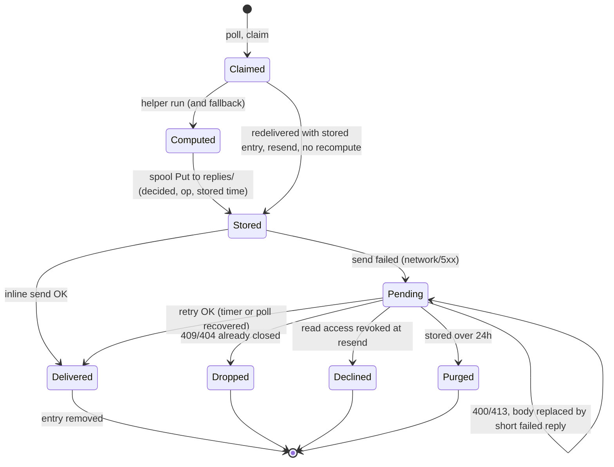
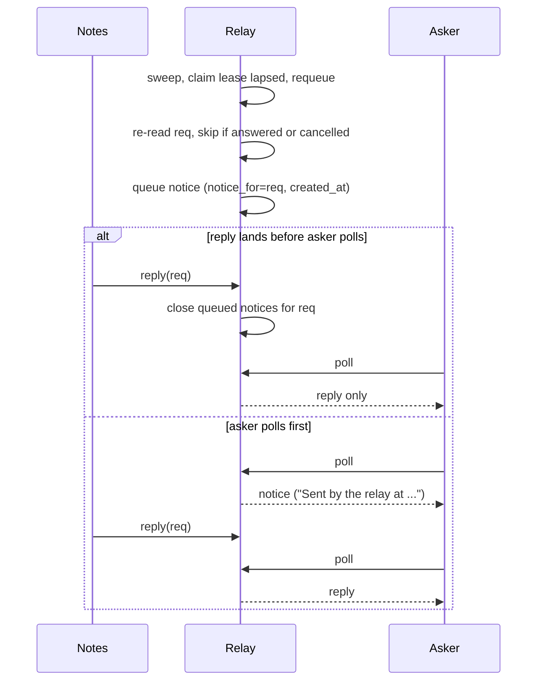

# Notes Reply Delivery, Lease Notices and Search Fallback - Plan

## Goal Capsule

- Objective: When a teammate asks Notes for something that is in the owner's Agent Notes library, the asker gets the right answer as soon as the relay is reachable again, gets it once, is never shown a "lapsed and requeued" notice as news after the answer arrived, and a natural-language request for a family note finds that note.
- Means: keep every computed Notes reply on disk and retry it (KTD1, KTD2), link relay notices to their request so an answer supersedes them (KTD5), add a ranked fallback for zero-match multi-word searches (KTD7), and timestamp the lifecycle (KTD8).
- Authority: this plan's Requirements govern product behavior; KTDs govern mechanism; `CONTRIBUTING.md` and the P0 rules in `greptile.json` for `internal/relay/**` and `internal/store/**` override both where they conflict.
- Execution profile: one PR against `main` in the agent-tincan repo. Units are ordered for one branch.
- Stop conditions: stop and report if a relay store migration cannot stay backward compatible with v0.21.0 clients, or if the Agent Notes helper cannot run several searches inside one request budget without timing out.
- Who finishes: the executor builds, tests and opens the PR. Rolling the relay to the relay VM (`tincan relay-upgrade`) and replacing `~/bin/tincan` for the Notes LaunchAgent are post-merge steps for the owner's machines, not part of this PR.

---

## Product Contract

### Summary

Notes keeps each answer it computes until the relay accepts it, so a relay outage delays an answer instead of losing it. The relay ties each lease-lapse notice to the request it is about, so a reply supersedes a notice the asker has not received yet, and every notice says when it was made. A multi-word search that matches nothing falls back to the notes matching most of its words. Every step of a request is logged with a timestamp, and the incident is replayed as regression tests.

### Problem Frame

On 2026-11-08 an agent (`instinct`) asked Notes (request `6de87e066b64c92b3674`) for six family members' Alaska Airlines numbers at 21:55:07 PST. Notes claimed it at once, computed an answer within about ten seconds, and sent one reply. The reply failed with a dial timeout: from about 21:44 to 22:24 every Tincan service on the Notes Mac lost the relay, with only short windows of contact. Notes logged the failure and kept nothing, so the request sat claimed with nobody working on it. The relay's 30-minute claim lease lapsed at 22:25:08. The relay requeued the request and queued a lease-lapse notice for the asker. Notes ran the search again and replied at 22:25:17. The asker received the notice at 22:26:01, 44 seconds after the answer.

The answer was also wrong. The Agent Notes helper requires every search term to match. The family note contains "Alaska", "Airlines" and all six names but not "Mileage" or "Plan", so the extracted query matched nothing and Notes replied "No notes match". A follow-up with the same all-words shape failed again. Only a single-word "Alaska" search found the note, at about 22:27.

Of the 30m10s from ask to answer, about 20 seconds went to two searches and about 30 minutes went to waiting for a lease to lapse over an answer that had already been computed. The full timeline is in the Appendix.

### Requirements

Reply delivery

- R1. A reply Notes has computed for any operation (add, search or read) survives relay failures and Notes restarts, and is delivered when the relay next accepts it.
- R2. Delivery retries are idempotent: a request gets at most one accepted reply, and a resend the relay rejects as already closed is treated as done.
- R3. Retries back off and are capped, never block polling, and resume promptly once the relay answers again.
- R4. A reply that cannot be delivered is visible to the owner, through `tincan notes doctor` and the notes health file, as request ids, counts, ages and the last error class, never reply text.
- R5. A stored search or read reply is resent only if its asker still has read access when it is resent.
- R6. A stored search or read reply is deleted once delivered or once the relay reports its request closed, and never stays on disk more than 24 hours after it was stored.

Lease handling and notices

- R7. When a request whose reply is stored is redelivered after a lease lapse, Notes resends the stored reply and does not run the work again.
- R8. A lease-lapse notice whose request gets a terminal reply or is cancelled before the asker polls for the notice is not delivered. Expiry notices always deliver. Webhook and email askers may already have been woken by a superseded notice (Scope Boundaries).
- R9. Every relay notice states the UTC time the relay created it, and the asker's inbox view shows that time.

Search

- R10. A multi-word search that matches no active note retries with its individual words and returns the notes matching the most of them.
- R11. A fallback reply says plainly that no note contained every word, and lists for each note which of the query's words it matched. The query in the Appendix's incident must return the family note first.
- R12. The fallback finishes inside the request's time budget; words it could not search in time are named in the reply.

Logging and tests

- R13. Notes log lines carry a timestamp. Each request logs claim, operation finished with its duration, every reply attempt with its outcome, the next retry time, delivery, drop with reason, and purge.
- R14. The trace view shows each event's relay time.
- R15. Diagnostic output (logs, health file, doctor, test failure messages) never contains reply bodies, note text or loyalty numbers. Test fixtures use invented numbers.
- R16. Regression tests cover a relay outage with recovery, a reply delayed past the lease, a lease lapse with redelivery, a notice superseded by a reply, and this exact query shape against a fake helper that requires every word to match.

### Acceptance Examples

- AE1. Covers R1, R3, R7. Given Notes computed a search reply and the relay is unreachable, when the relay comes back before the claim lease lapses, then the stored reply is delivered within one retry interval of the first successful poll, and no lease notice is created.
- AE2. Covers R7, R8. Given the outage outlasts the lease, when the relay requeues and redelivers the request, then Notes resends the stored reply without calling the helper, and a polling asker's inbox never shows the lease notice.
- AE3. Covers R10, R11. Given a library holding a note titled "Family Alaska Airlines Numbers" that contains "Alaska", "Airlines" and six names but not "Mileage" or "Plan", when Notes searches "Alaska Airlines Mileage Plan" followed by the six names, then the reply says no note had every word and lists that note first, as matching 8 of 10 words.
- AE4. Covers R5. Given a stored search reply for an asker since removed from the read allowlist, when the relay comes back, then Notes sends a declined reply with the standard reason and deletes the entry.

### Scope Boundaries

- The tailnet outage between the Notes Mac and the relay is not fixed here. `relay-watch` already exists for it.
- The Agent Notes app's all-words search is unchanged. The fallback lives in Tincan's Notes agent.
- Considered and not built: holding lease notices back for a grace period before they are queued or wake the asker. Webhook and email askers can still be woken by a notice that is superseded before they poll. The notice now carries its creation time (R9), so it can't be mistaken for news. Would change if an email or webhook asker reports a superseded notice reaching them.
- Considered and not built: re-checking whether each note in a stored search reply is still active before resending. The reply described the library at the time it was computed, a stored reply lives at most 24 hours (R6), and the read allowlist recheck (R5) covers the access risk. Would change if the 24-hour cap were raised.
- Considered and not built: posting progress notes to renew the claim lease while the relay answers but refuses the reply. A lapse is now harmless: the stored reply is resent on redelivery (R7) and the lease notice is superseded (R8). Would change if a server-side reply refusal were seen to last past the lease.
- Considered and not built: weighting rare words above common ones in the fallback ranking. Matched-word count plus the title tie-break already puts the family note first on the incident query, and the helper returns no library size to weight against. Would change if fallback replies were seen to rank common-word matches above the note the asker wanted.
- Considered and not built: giving the asker an option to turn the fallback off. No caller relies on an empty result. The fallback reply is labelled (R11), so an asker that needs every word can tell the difference.
- Considered and not built: handing back open claims when Notes restarts mid-request. A crash between claim and storing the reply still waits out the 30-minute lease. Would change if restart-before-store shows up in logs.

#### Deferred to Follow-Up Work

- Timestamped `logf` for the history, web, council and pass services, which share the unstamped `tincan <svc>:` shape (KTD8).

---

## Planning Contract

### Key Technical Decisions

- KTD1. Store decided search and read replies in their own spool subdirectory. A search or read entry is written only after its reply is computed, to `replies/` under the existing spool directory (`internal/notes/spool.go`). It carries the request's op, a new answered outcome, the reply body and its stored time. Adds keep today's path: `decide` already records an add's outcome and reply before `sendFinal`, so a decided add is resent without a second create. Every consumer of `replies/` routes only to the resend path, and only `OpAdd` entries in the top-level directory can reach `helper.Create`. Rationale: v0.21.0's `Spool.List` skips directories, so rolling the binary back can never turn a stored search into a junk note. Top-level entries with no op keep meaning "add".
- KTD2. One inline send, then off-loop retries. After computing, Notes stores the entry, makes one send on the poll loop (as today), and on failure leaves the entry to the retry goroutine. Retries back off per entry, in memory, at 2s, 5s, 15s, 30s, then 60s. A restart retries every stored entry at once. A wrapper around `Service.PollOnce` triggers an immediate retry pass when a poll succeeds after failing. Rationale: `history.RunPolling` is shared with four other services and has no recovery hook, and the incident had short contact windows (21:55:07, 22:16:25) that a prompt retry could have used.
- KTD3. Classify reply errors. 409 and 404 mean already closed: drop the entry. 400 and 413 cannot succeed with the same body, so the entry's reply is replaced with a short failed reply naming the error class, and that replacement is retried like any other entry. 401 and 403 mean misconfiguration: keep the entry, hold at the 60s cap, and report it (R4). Network errors and 5xx retry. An entry in `replies/` more than 24 hours old is purged with a logged reason. Undecided add entries keep their existing `stillWanted` rules and are never purged by age. Notes cannot see a request's relay expiry (Notes requests get `NotesRequestTTL`, 30 days by default), so the 24-hour cap is the retention bound.
- KTD5. Link lease notices to their request in the relay store. The relay-created stale-claim notify gets a relay-only `notice_for` request id and notice kind, stored in new `requests` columns. They are added with the existing `migrateX` plus `ALTER TABLE requests ADD COLUMN` pattern (`internal/store/followups.go`) and carried on `envelope.Request` as `json:"-"` fields, like `FollowOf`. When `recordReplyWith` accepts a terminal reply, or the request is cancelled, queued stale-claim notices for that request are closed without delivery in the same transaction. `tellSwept` already re-reads the request before building the notice. It skips the notice when that read shows answered, declined, failed or cancelled, which covers a reply that lands between the requeue and the enqueue. Expiry notices are never linked or suppressed. Old clients see no wire change.
- KTD6. Put the creation time in the notice body and the inbox view. `askerNotice` appends "Sent by the relay at <UTC clock>" using `client.UTCClock`, as `wakeNote` already does. `client.FormatRequest` shows `CreatedAt` for relay notices. The body change reaches every client version. The render change makes the time visible for any relay version.
- KTD7. Fallback in the Notes agent, ranked by words matched. It triggers only when the helper returns no active note for a query of two or more words. The first 12 distinct words of three or more characters, in query order after a short stopword list, are each searched serially under one 90-second sub-budget, inside the 3-minute `DefaultRequestTimeout`. Words past the cap or past the budget are named in the reply. Only active notes count. Notes rank by number of query words matched. Ties break by matched words in the title, then pinned, then note id: `NoteSummary` carries no modified time. The reply lists up to the request's count and names the matched words per note. Rationale: the app's search is shared with its UI, and the fix belongs where natural-language requests come in. Against the live library the family note ties another note at 8 of 10 words and wins the title tie-break, 2 title words to 0 (Appendix).
- KTD8. Timestamp the notes logger only. `Service.logf` prefixes RFC 3339 local time with milliseconds. Lifecycle lines name the request id, op, duration, attempt number, error class and next retry time. They log no bodies. Other services keep their format for now (Deferred).
- KTD9. The MCP trace tool renders each event's `at`. The relay already returns it in `/v1/trace` (`store.AuditEvent.At`). The decode struct in `internal/mcpserver/server.go` drops it today.

### High-Level Technical Design

Notes reply lifecycle after this change:

Relay notice supersession:

### Assumptions

- The Agent Notes helper tolerates up to 13 sequential `search` runs inside one request. Each run is a separate process with the existing 60-second `helperTimeout`. Measured runs against the live library took 1.5 to 1.9 seconds.
- Helper `search` returns every match uncapped. A single-word probe returned 1334 notes.
- No other runtime polls as the `notes` agent. If one does, a redelivery goes there and is computed again. The original's stored entry then gets 409 and is dropped, which is correct but costs a second search.

---

## Implementation Units

### U1. Timestamped Notes lifecycle logging and trace event times

- Goal: make every Notes request reconstructable from its log and the relay trace.
- Requirements: R13, R14, R15.
- Dependencies: none.
- Files: `internal/notes/serve.go`, `internal/notes/serve_test.go`, `internal/mcpserver/server.go`, `internal/mcpserver/server_test.go`.
- Approach:
  1. Stamp `Service.logf` (KTD8) with an injectable clock so tests can assert the exact time.
  2. Add lifecycle lines at claim, operation finished (op, duration, match counts), each reply attempt, drop, purge and resend. Request ids only.
  3. Decode and render `at` in the trace tool's event lines (KTD9).
- Patterns to follow: `testLog` substring assertions in `internal/notes/serve_test.go`. Relay UTC clock format via `client.UTCClock`.
- Test scenarios:
  - A search request logs claim, "search finished" with duration and counts, and "reply delivered", each starting with a parseable timestamp.
  - A failed reply attempt logs attempt number, error class (network, 5xx, 409) and the next retry time.
  - No log line produced during the suite contains a reply body or note text. Assert against a fixture body with a distinctive invented number.
  - The trace tool output includes each event's time in UTC alongside its sequence number.
- Verification: the incident timeline in the Appendix can be rebuilt from Notes logs and `trace` output alone.

### U2. Store computed search and read replies; resend on redelivery

- Goal: an answer Notes has computed is never lost or recomputed.
- Requirements: R1, R2, R5, R6, R7.
- Dependencies: U1.
- Files: `internal/notes/spool.go`, `internal/notes/spool_test.go`, `internal/notes/serve.go`, `internal/notes/serve_test.go`.
- Approach:
  1. Extend `SpoolEntry` and `Outcome` per KTD1 with an op discriminator, an answered outcome and a stored time, and give the spool a `replies/` subdirectory with its own list. A top-level entry with no op reads as an add.
  2. In `search` and `read`, store the decided reply in `replies/` before the first send. Send through the existing `sendFinal` path instead of `reply`.
  3. In the `Handle` redelivery branch and in `RetrySpooled`, route decided search/read entries to a resend path. That path rechecks the read allowlist (`readAllow`, `eitherAllow`) and sends declined on denial (R5). It never touches the helper.
  4. Make the panic path and its messages op-aware.
- Execution note: start with a failing test reproducing the incident (search computed, reply fails, lease lapses, redelivery recomputes) before changing the spool.
- Patterns to follow: `TestReplyFailureThenRedeliveryRepliesSameNoteID`, `TestSpooledAddAlreadyRepliedIsDropped`, `putOldEntry`, `restart`, and the `replyFail` / `replyLose` proxy faults in `internal/notes/serve_test.go`.
- Test scenarios:
  - A search whose reply fails once is stored; the next retry delivers the same body; the entry is removed.
  - The incident path: reply fails, the lease lapses (`redeliver`), and redelivery resends the stored reply with zero extra helper `search` calls (`callsOf`).
  - A read reply stored before a Notes restart is delivered by the restarted service.
  - A reply whose response is lost (`replyLose`) and is resent gets 409, and the entry is dropped with one reply on the relay.
  - A stored search reply whose asker was removed from the read allowlist is answered declined and deleted (AE4).
  - An old-format add entry (no op, no outcome) still goes through the add path unchanged.
  - A decided search entry is never passed to `helper.Create`.
  - The v0.21.0 `Spool.List` behavior (top-level files only) does not see entries in `replies/`, so a rolled-back binary cannot act on them.
- Verification: AE2 holds in a test against the test relay. The existing notes suite passes unchanged except the replaced "a search or read never writes a spool entry" expectation.

### U3. Retry scheduling, error classes and visible pending status

- Goal: stored replies go out as soon as the relay allows, without blocking polling, and stuck ones are visible.
- Requirements: R3, R4, R6, R16.
- Dependencies: U2.
- Files: `internal/notes/serve.go`, `internal/notes/spool.go`, `internal/notes/serve_test.go`, `internal/cli/notes.go` (`runNotesDoctor`) and `internal/cli/notes_test.go`, `internal/notes/service.go` if the health path changes.
- Approach:
  1. Replace the fixed ticker pass with in-memory per-entry due times (KTD2). A pass only attempts entries that are due.
  2. Wrap `PollOnce` to detect a failing-to-succeeding transition and signal the retry goroutine.
  3. Apply KTD3 error classes and the 24-hour purge of `replies/`.
  4. Extend `Health` with pending count, oldest pending age, and last error class per id. Surface them in `tincan notes doctor`.
- Patterns to follow: `TestRunDrainsSpoolAndKeepsPolling`. Add a `pollFail` hijack on `/v1/poll` to the rig, next to `getFail`.
- Test scenarios:
  - Poll and reply both fail, then recover: the stored reply is delivered within one retry interval of the first good poll, and no lease notice exists (AE1).
  - While retries are failing, a second request is still claimed and answered on time, so polling is never held by a retry.
  - Attempt times follow the backoff schedule and stop growing at 60s.
  - A 413 reply replaces the stored body with a short failed reply. When that send then fails on the network, the replacement is retried and delivered once the relay returns.
  - A 403 keeps the entry, holds at the cap, and shows in health.
  - A `replies/` entry stored more than 24 hours ago is purged with a logged reason and nothing sent.
  - An undecided add entry older than 24 hours is still written and answered, not purged.
  - Doctor output lists the pending id and age and contains no reply text.
- Verification: with an injected outage longer than the claim lease, the test relay sees exactly one accepted reply and Notes runs the helper exactly once.

### U4. Relay notices: link, supersede, timestamp

- Goal: a notice is never delivered after its request was answered or cancelled, and always says when it was made.
- Requirements: R8, R9, R16.
- Dependencies: none (parallel to U2-U3 on the same branch).
- Files: `internal/store/store.go`, a new migration in `internal/store/` following `followups.go`, `internal/envelope/envelope.go`, `internal/relay/wakenotice.go`, `internal/relay/server.go`, `internal/client/render.go`, tests in `internal/relay/held_test.go`, `internal/store/store_test.go`, `internal/client/render_test.go`, and docs `docs/protocol.md`.
- Approach:
  1. Add the relay-only columns and fields (KTD5). Set them in `askerNotice` for stale-claim notices only.
  2. On a terminal reply or cancel in `recordReplyWith` and the cancel path, close queued stale-claim notices for that id in the same transaction, recording an audit event.
  3. In `tellSwept`, skip the stale-claim notice when the re-read request is answered, declined, failed or cancelled.
  4. Append the creation time to the notice body and render `CreatedAt` for relay notices (KTD6).
  5. Update the exact-text tests and `docs/protocol.md` for the new notice sentence.
- Patterns to follow: `sweepHarness` with its fake clock in `internal/relay/held_test.go`; `TestUrgentClaimLeaseAndStaleClaimNotice`; `TestStaleClaimNoteNamesOnlyListedTeammates`; migrations in `internal/store/followups.go` and `failover.go`. Read the `greptile.json` P0 rules first.
- Test scenarios:
  - Lease lapses, the notice is queued, the target replies before the asker polls: the asker's next poll returns the reply and no notice (AE2).
  - The asker polls before the reply: the notice is delivered with "Sent by the relay at <time>" matching its creation time; the later reply is still delivered.
  - The asker cancels the original before polling: the notice is not delivered.
  - A reclaim or progress after the lapse, with no reply yet, leaves the notice deliverable.
  - A reply recorded between the sweep's requeue and the notice build means no notice is queued.
  - An expiry notice for an expired request is still delivered.
  - A database from v0.21.0 migrates, and existing queued notices without a link still deliver.
  - The inbox render for a relay notice shows its creation time.
- Verification: the incident sequence replayed with the fake clock delivers the reply and no notice. Relay tests and store migration tests pass.

### U5. AND-semantics fake helper and the ranked search fallback

- Goal: a natural-language request finds the note that matches most of its words, and the reply says how it matched.
- Requirements: R10, R11, R12, R15, R16.
- Dependencies: U1 (logging), U2 (stored replies carry fallback output).
- Files: `internal/notes/fakehelper_test.go`, a new `internal/notes/fallback.go` and `internal/notes/fallback_test.go`, `internal/notes/serve.go` (`search`, `searchReply`), `internal/notes/serve_test.go`.
- Approach:
  1. Change the fake helper's search to match the real helper CLI: a note matches when its title, body or a tag holds the whole lowercase query, or, for two or more words, every word, each as a lowercase substring.
  2. Implement KTD7 as a pure ranking function over per-word results plus a driver that runs the per-word searches under the shared sub-budget.
  3. Add fallback reply wording for: closest matches found; nothing found by any word; budget ran out before some words.
- Execution note: write the AE3 test against the AND fake first and watch it return "No notes match" before adding the fallback.
- Patterns to follow: the fake helper's `put` and `callsOf`; `searchReply` truncation at `maxReplyBytes`.
- Test scenarios:
  - AE3: the incident query against a fixture library ranks the family note first with "matches 8 of 10 words", using invented loyalty numbers in the fixture. The fixture includes a second note with the same 8 words in its body but none in its title, and that note ranks second.
  - A query whose full form matches returns the normal reply and runs no fallback searches.
  - A single-word query with no match replies "No notes match" with no fallback.
  - Ties at equal word count order deterministically by title-word matches, pinned, then id.
  - Duplicate, stopword and two-letter words are dropped, only the first 12 words are searched, and the reply names words past the cap.
  - A helper that sleeps past the sub-budget yields a reply naming the unsearched words.
  - Trashed or archived notes found by per-word searches are not listed.
- Verification: AE3 passes, and the existing search tests pass against the AND fake.

### U6. Docs and an end-to-end incident regression

- Goal: the docs match the new privacy and delivery behavior, and one test replays the whole incident.
- Requirements: R6, R15, R16.
- Dependencies: U2, U3, U4, U5.
- Files: `docs/adapters/notes.md`, `docs/protocol.md`, `README.md` (the Notes section, if it describes the spool or search), `internal/notes/serve_test.go`.
- Approach:
  1. Update `docs/adapters/notes.md` so the spool holds stored replies, including note text, in `replies/` until delivery or for at most 24 hours, with 0700/0600 permissions. Describe the fallback reply.
  2. Add an incident test: poll and reply outage across the claim lease, then recovery, with the exact query shape.
- Test scenarios:
  - Incident replay: the asker's inbox holds exactly one reply from Notes. That reply lists the family note first. No lease notice is delivered. The helper ran the per-word searches once, not twice.
- Verification: a reader of `docs/adapters/notes.md` learns what the spool holds, how long, and what happens on outage.

---

## Verification Contract

| Gate | Command | Applies to |
|---|---|---|
| Unit and integration tests, race detector | `make test` | All units |
| Focused notes suite | `go test -race ./internal/notes/` | U1, U2, U3, U5, U6 |
| Focused relay and store suites | `go test -race ./internal/relay/ ./internal/store/ ./internal/client/ ./internal/mcpserver/` | U1, U4 |
| Lint and vet | `make lint` and `make vet` | All units |
| Leak check | grep the test output and any spool fixtures for the invented fixture numbers outside reply assertions | R15 |

Per `CONTRIBUTING.md`, each bug fix lands with a test that fails without it, and protocol additions stay optional.

## Definition of Done

- AE1 to AE4 pass as automated tests, and the U6 incident replay passes.
- `make test`, `make lint` and `make vet` are clean.
- A v0.21.0 relay database migrates, and a v0.21.0 Notes spool directory loads without loss.
- `docs/adapters/notes.md` and `docs/protocol.md` describe the new spool contents, notice sentence and fallback reply.
- No diagnostic surface prints reply bodies or note text.
- Code from abandoned approaches is removed from the diff.
- The PR description lists the post-merge rollout: relay upgrade on the relay VM, then the Notes binary on the Notes Mac.

---

## Appendix

### Incident timeline (2026-11-08, PST; relay times from `tincan trace --format json`)

| Time | Event | Source |
|---|---|---|
| 21:44-22:24 | Relay unreachable from the Notes Mac for notes, claude-web, chatgpt-web, history and council alike, with brief contact windows | `~/Library/Logs/tincan-*.log` |
| 21:55:06.991 | Request `6de87e06...` created by `instinct` | relay request |
| 21:55:07.008 / .137 | Delivered to and claimed by notes | events #13807, #13808 |
| before 21:55:34 | Search finished: 0 of 0 matches | notes log |
| about 21:55:37 | Reply POST failed: `dial tcp ... i/o timeout`. Nothing kept | notes log |
| 21:55-22:25 | Claim held with no work. Poll loop retrying 1-30s, not blocked | notes log |
| 22:16:25 | Brief relay contact. No reply retry existed to use it | notes log |
| 22:25:08.096 | Claim lease lapsed (30m), request requeued | event #13854 |
| 22:25:08.101 | Lease notice `35b5f739...` created for the asker, generated on time, not stale | events #13855, #13856 |
| 22:25:08.166 | Redelivered and claimed again by notes | events #13857, #13858 |
| 22:25:17.649 | Second search (0 of 0) replied | event #13860 |
| 22:26:01.089 | Asker received the lease notice, 44s after the answer | events #13862, #13863 |
| 22:26:26 | Follow-up `3c41ba6e...` with a combined query, 0 matches again | relay request |
| about 22:27 | Single-word searches found the family note. Owner received the numbers at 22:27:08 | notes log, owner report |

Each handling took about 10 seconds from claim to reply, free-text extraction included. A bare helper search takes 1.5 to 1.9 seconds. Waiting to deliver was 29m51s. The 20.9s ping at about 22:06 fits the outage: pings are answered from Notes' poll, which was failing and backing off up to 30s. No other Notes requests were queued in the window, so nothing was blocked behind a retry. The client upgrade to v0.21.0 at about 22:24 was on the asker's machine. Notes had been running `~/bin/tincan` since 19:23:32 and did not change.

### Search semantics, verified against the live library

The helper CLI's `search` (agent-notes-mac `AgentNotesCommandEngine`) matches a note when its title, body or tags hold the whole query, or every word, as lowercase substrings. The app's UI index likewise joins terms with AND (`SearchQuery.ftsExpression`). Per-word probes against the live library, counts only: "Mileage" and "Plan" do not match the family note. "Alaska", "Airlines" and each of the six names do. The full ten-word query matches 0 notes. The same query without "Mileage" and "Plan" matches 2, the family note and one other active note. Adding either "Mileage" or "Plan" back matches 0, so the other note also matches exactly 8 of 10 words. The family note's title holds 2 of the query words and the other note's title holds none.
