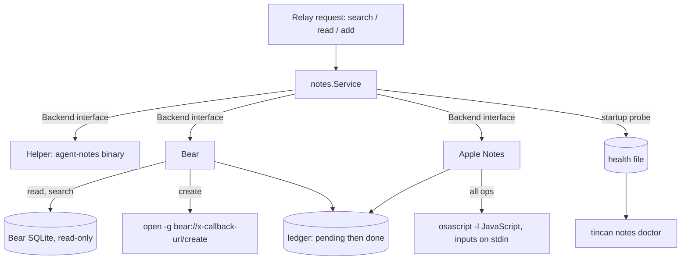

# Bear and Apple Notes backends for the Notes agent - Plan

## Goal Capsule

- Objective: an owner who keeps notes in Bear or Apple Notes can run the Tincan Notes agent against that app, so teammates can search, read and add notes there exactly as they can with Agent Notes today.
- Means: a `Backend` interface inside `internal/notes` with three implementations, selected by `--backend` (KTD1, KTD2).
- Authority: this plan's Requirements, then its KTDs, then unit Approaches. The relay protocol and the Notes request and reply formats are fixed and out of scope.
- Execution profile: one PR, stacked on PR #215 (`fix/notes-reply-delivery`), because both change `internal/notes/serve.go`.
- Stop conditions: stop and report if the installed Notes service process cannot open Bear's database read-only after the owner grants the permission doctor names, or if Apple Notes scripting cannot return note ids. Each would change the design, not just the code.
- Who finishes: the implementing agent builds, verifies, opens the PR and babysits it. Matt merges.

---

## Product Contract

### Summary

Add two backends to the Notes agent: Bear and Apple Notes. The owner picks one with `tincan notes serve --backend bear` (or `apple-notes`); `agent-notes` stays the default. Search, read and add work the same way from a teammate's side, including the reply spool, idempotent adds, the multi-word search fallback and doctor.

### Problem Frame

The Notes agent only works with the Agent Notes app, which is not public yet. Matt wants to announce the Notes feature, and most people who would try it keep their notes in Bear or Apple Notes. Both apps are scriptable on macOS, and Bear is installed on this Mac with about 11,000 notes.

### Requirements

Backend selection

- R1. `tincan notes serve`, `tincan notes install` and `tincan notes doctor` take `--backend agent-notes|bear|apple-notes`, defaulting to `agent-notes`; `--library-root` and `--helper` apply only to `agent-notes`.
- R2. An installed service keeps its backend across restarts (the backend is written into the launchd and systemd definitions).
- R3. Replies, progress notes, logs and doctor name the backend the owner chose ("Bear", "Apple Notes", "Agent Notes"), never another one.

Operations

- R4. Search returns the notes whose title or text contains every word of the query, with Unicode case-insensitive matching, with id, title, state, pinned, tags and a snippet; the existing per-word fallback then works unchanged.
- R5. Read returns one note's title and plain text by id. A note that does not exist is "not found", and a locked or encrypted note is refused with a reply that says it is locked. A locked note's text is never searched or shown in a snippet.
- R6. Only active notes are answered to teammates' search and read, as today; trashed, archived (Bear) and Recently Deleted (Apple Notes) notes are not.
- R7. Add creates a note with the title, body and tags without bringing the app to the foreground.
- R8. A redelivered add never creates a second note (idempotency), on both new backends, and a separate add that happens to have the same content is still saved.

Safety

- R9. The Bear backend never writes to Bear's database; every change goes through Bear's own URL scheme.
- R10. Note text never reaches a script's source code; it is passed as data, so a note cannot inject script.
- R11. Logs and doctor output carry ids, counts and error codes only, never note text, as today.

Operability

- R12. `tincan notes doctor --backend <b>` tells the owner whether the installed service can use the backend and, when it cannot, the exact fix (install the app, grant a macOS permission).
- R13. Install and doctor warn when a Bear or Apple Notes service runs with no read or add allowlist file, because every joined agent can then read the owner's whole note store, and name the file to create.

### Scope Boundaries

- Not in scope: editing or deleting notes, attachments and images, Bear or Apple Notes on iOS, non-macOS hosts for these two backends (they report unsupported).
- Deferred for later: an Obsidian backend (a folder of markdown files, easy to add on the same interface), and a search index or cache for very large Apple Notes libraries.
- Unchanged: the relay, the Notes request and reply wire formats, the spool, allowlist semantics, and the Agent Notes helper behavior.

### Assumptions

- The installed Notes service can open Bear's group-container database read-only once the owner grants it the macOS permission doctor names; the service's own startup probe detects a denial (U6).
- Apple Notes scripting is reachable from the launchd service after the owner approves the one-time Automation prompt, which the service's startup probe raises.
- Bear 2.x schema (`ZSFNOTE`, `ZSFNOTETAG`, and a `Z_<n>TAGS` join table) is stable enough to read; join-table column names are discovered at open time rather than hard-coded.

---

## Planning Contract

### Key Technical Decisions

- KTD1. Backend interface, not a second helper binary. New file `internal/notes/backend.go` holds `type Backend interface { Name() string; Create(...) (CreateResult, error); Search(ctx, query) ([]NoteSummary, error); Read(ctx, id) (Note, error); Probe(ctx) (int, error) }`. `*Helper` implements it; the service's `helper` field is renamed to `backend` and retyped. Every backend returns notes in any state, as `*Helper` does, and the service keeps filtering non-active notes itself (R6), so its "already saved, later trashed" notices keep working. A new sentinel `ErrNoteLocked` joins `ErrNoteNotFound`. `internal/notes/library.go` (Agent Notes library discovery) is unchanged; "library" keeps meaning the Agent Notes library root.
- KTD2. One `--backend` flag with three values (R1). `Config.Backend` selects the implementation in `NewService`. The service templates in `internal/notes/service.go` gain `--backend "__BACKEND__"`, and `__LIBRARY_ROOT__`/`__HELPER__` are written only for `agent-notes`.
- KTD3. Bear reads go straight to SQLite, opened read-only. Path: `~/Library/Group Containers/9K33E3U3T4.net.shinyfrog.bear/Application Data/database.sqlite`, opened with `mode=ro` and `query_only` through the repo's `modernc.org/sqlite`, with a busy timeout; BUSY, CANTOPEN and a hot journal are transient `helper_unavailable`. Mapping: id `ZUNIQUEIDENTIFIER`, title `ZTITLE`, body `ZTEXT`, pinned `ZPINNED`, state `trashed` when `ZTRASHED`, `archived` when `ZARCHIVED`, otherwise `active`; rows with `ZPERMANENTLYDELETED` are skipped. `ZENCRYPTED` or `ZLOCKED` notes match on title only, get an empty snippet, and Read returns `ErrNoteLocked` (R5). Search runs the all-words match in SQL through a Go scalar function registered on the connection that applies Unicode case folding, with `%` and `_` in query words matched literally. Bear's x-callback search is not used: it opens the app window and cannot answer a background process.
- KTD4. Bear creates go through `bear://x-callback-url/create` opened with `open -g` (R7, R9), with `open_note=no`, `show_window=no` and percent-encoding that turns spaces into `%20`, never `+`. The created note is found by polling for exactly one note created at or after the attempt's recorded start whose normalized title equals the sent title (Bear may store the title as a `# ` heading line and append tags, so the comparison strips a leading `#` heading marker, trailing tag tokens and surrounding whitespace). Two or more candidates is a failed add that tells the owner the note may already be in Bear, never a guess. Bear's argv exposure of the URL matches today's Agent Notes helper, which already takes `--body` as an argument.
- KTD5. Idempotency for apps without it is a local ledger with a pending state (R8). A JSON ledger in the service's Application Support directory (0600, atomic rename) maps an idempotency key to `{state: pending|done, start, title, note_id, props}`. A create first writes a pending entry, then calls the app, then polls, then marks it done. A retry whose key is done returns `Existed: true` with the note in whatever state it is now. A retry whose key is pending never calls the app again: it reruns the KTD4 or KTD6 lookup for that attempt and adopts the note if found; if it is still missing after the poll window on the retry, the add is decided failed with a reply that the note may exist. A key with no entry creates directly, so a different add with the same content is saved (R8). Provenance properties have no field in either app and are kept in the ledger entry only.
- KTD6. Apple Notes uses JXA through `osascript -l JavaScript`, with fixed scripts embedded in the binary; inputs arrive as one JSON object on stdin, read in the script through the ObjC bridge, so note text appears in neither the script source (R10) nor the process arguments. Each script returns one JSON line; the runner's output cap is raised for search so a large library fails slow rather than with `helper_bad_output`. Search walks each account's folders and bulk-fetches `id`, `name`, `plaintext` and `passwordProtected` per folder (one Apple Event per property per folder); notes in the deleted-notes folder, matched against a shipped set of localized "Recently Deleted" names, are `trashed`, and doctor reports which folder it treated as deleted. Locked notes match on name only. Read uses `notes.byId`. Create builds escaped HTML in Go (a title line, one `
` per body line, then a `#tag` line when tags are given) in the default account's default folder; the KTD5 lookup matches the first plaintext line against the title. Pinned is always false; scripting does not expose it.
- KTD7. Backend failures reuse the existing `HelperError` codes so permanence, health and doctor keep working: a missing app or database is `helper_unavailable` (transient), a macOS permission denial (osascript -1743, or EPERM opening Bear's container) is a new transient code `permission_denied`, and bad input stays `invalid_request` (permanent). `Service.read` answers `ErrNoteLocked` with a locked reply and records health OK, as it does for not-found.
- KTD8. Doctor trusts the service, not the terminal. macOS grants App Data and Automation permissions to the responsible process, and a Terminal-run probe inherits Terminal's grants. So the service runs `Backend.Probe` at startup and after each `permission_denied`, and records the result in its health file. Doctor reports that recorded result as authoritative and labels its own probe "from this terminal". The service's first probe is what raises the Automation prompt for the service.
- KTD9. Stack on PR #215. Its spool, fallback and health changes are in `serve.go`; branching from `main` would conflict with both. The PR targets `fix/notes-reply-delivery` and GitHub retargets it to `main` when #215 merges.

### High-Level Technical Design

### Risks

| Risk | Mitigation |
|---|---|
| macOS blocks the launchd service from Bear's group container | The service's startup probe records `permission_denied`; doctor names the setting to grant (KTD8) |
| The Apple Notes Automation prompt never shows for a launchd process | The service's own probe raises it; if it still never appears, doctor reports -1743 with the manual fix |
| Bear changes its schema or how it stores titles | Columns checked at open; normalized title comparison; ambiguous matches fail closed (KTD4) |
| A "Recently Deleted" name the shipped set does not know | Doctor shows the folder it treated as deleted, so an owner can spot a miss; adding names is a one-line change |
| Apple Notes is slow on very large libraries | Per-folder bulk fetch; the 60s helper timeout still applies; a cache is deferred |

---

## Implementation Units

### U1. Backend interface and backend selection

- Goal: the service talks to a `Backend`, and `--backend` picks it (R1, R2, R3).
- Requirements: R1, R2, R3, R5; KTD1, KTD2, KTD7.
- Files: `internal/notes/backend.go` (new), `internal/notes/serve.go`, `internal/notes/helper.go`, `internal/notes/service.go`, `internal/cli/notes.go`, tests `internal/notes/serve_test.go`, `internal/notes/service_test.go`, `internal/cli/notes_test.go`.
- Approach: `*Helper` gains `Name()` and `Probe()`; replace the literal "Agent Notes" in reply and progress templates with the backend name; handle `ErrNoteLocked` in `Service.read`. Reject an unknown backend at flag parse time.
- Test scenarios:
  - `notes install --backend bear` writes `--backend "bear"` into the plist and omits `--library-root`.
  - `notes serve --backend nope` fails with a message listing the three values.
  - `notes serve` without `--backend` still requires a library root (agent-notes default unchanged).
  - A failed add on a fake Bear backend replies with "Bear", not "Agent Notes".
  - A fake backend returning `ErrNoteLocked` gets a locked reply and health stays OK.
- Verification: the existing `internal/notes` and `internal/cli` suites pass.

### U2. Idempotency ledger

- Goal: Bear and Apple Notes adds are idempotent without swallowing distinct adds (R8).
- Requirements: R8, R11; KTD5.
- Files: `internal/notes/ledger.go`, `internal/notes/ledger_test.go`.
- Approach: `Begin(key, title, start)`, `Done(key, id, props)`, `Lookup(key)`; temp-file write and rename, mode 0600; a corrupt file is moved aside as `.corrupt` and logged, not fatal.
- Test scenarios: begin then lookup is pending; done then lookup returns the id; a reopened ledger sees both; a corrupt ledger starts empty and keeps the bad file; the file mode is 0600.

### U3. Bear search and read

- Goal: search and read against Bear's database (R4, R5, R9, R11).
- Requirements: R4, R5, R6, R9, R11; KTD3, KTD7.
- Files: `internal/notes/bear.go`, `internal/notes/bear_test.go`.
- Approach: discover the tag join table as exactly `Z_<digits>TAGS` (not `Z_<n>PINNEDINTAGS`) whose columns reference `ZSFNOTE` and `ZSFNOTETAG`. Snippet comes from the text around the first matched word.
- Test scenarios (fixture DB with Bear's columns and both join tables, invented note text):
  - A three-word query returns only notes holding all three words, in title or text, any case.
  - A query `über` matches a note containing `Über`.
  - Trashed and archived notes come back with state `trashed` and `archived`; permanently deleted rows never come back; the service still answers only active ones.
  - A locked note whose text contains a query word is not returned for that word; matched by title, its snippet is empty; read returns `ErrNoteLocked`.
  - Tags come from `Z_5TAGS`, never from `Z_5PINNEDINTAGS`.
  - A query word containing `%` or `_` is matched literally.
  - The database file is byte-identical after search and read, and no `-wal` or `-shm` file is created beside it.
  - A missing database gives `helper_unavailable` naming Bear; an unreadable one gives `permission_denied`.

### U4. Bear create

- Goal: adds land in Bear in the background, exactly once (R7, R8, R9).
- Requirements: R7, R8, R9; KTD4, KTD5.
- Files: `internal/notes/bear.go`, `internal/notes/bear_test.go`.
- Approach: an injectable `open` runner; the fake runner in tests inserts the row into the fixture DB, optionally with Bear's heading and tag rewriting, after a delay, or never.
- Test scenarios:
  - The URL carries `open_note=no` and `show_window=no`, encodes spaces as `%20`, and survives `&`, `#`, `?`, newlines and emoji in title and body.
  - A stored note whose text starts with `# <title>` and ends with tags is still matched, and its id is returned.
  - A note that appears only after the poll window: the retry adopts it and `open` is called once in total.
  - A note that never appears: the first attempt is transient, the retry decides the add failed with the "may already be in Bear" reply, and `open` is called once in total.
  - Two candidate notes with the same title in the window: the add fails closed, no id is guessed.
  - A done key returns `Existed: true` without calling `open`.
  - A new key whose content equals an existing note still creates a note.

### U5. Apple Notes backend

- Goal: search, read and add in Apple Notes (R4 to R8, R10, R11).
- Requirements: R4, R5, R6, R7, R8, R10, R11; KTD5, KTD6, KTD7.
- Files: `internal/notes/applenotes.go`, `internal/notes/applenotes_scripts.go` (embedded JXA), `internal/notes/applenotes_test.go`.
- Approach: an injectable script runner (`osascript -l JavaScript -e <script>` with JSON on stdin) returning one JSON line; the real runner is used only on darwin.
- Test scenarios (fake runner):
  - Search filters the per-folder result to notes containing every word; notes in "Recently Deleted" and in a localized name such as "Zuletzt gelöscht" come back `trashed` and the service does not answer them.
  - Locked notes match by name only and have no snippet; read returns `ErrNoteLocked`.
  - Read by id maps a missing note to `ErrNoteNotFound`.
  - The script text and argv are byte-identical whatever the input; title, body and tags arrive only on stdin (R10).
  - Body HTML escapes `<`, `>`, `&` and keeps line breaks.
  - osascript error -1743 maps to `permission_denied`; a missing Notes app maps to `helper_unavailable`.
  - Pending and done ledger behavior as in U4, matching on the first plaintext line.
  - On a non-darwin build the backend reports unsupported.

### U6. Service probe, doctor checks, docs and live smoke

- Goal: owners can set up and debug either backend from the service's point of view (R12, R13), and the feature can be announced.
- Requirements: R11, R12, R13; KTD8.
- Files: `internal/notes/serve.go` (startup probe into health), `internal/cli/notes.go`, `internal/cli/notes_test.go`, `internal/notes/live_test.go`, `docs/notes-backends.md` (new), `README.md` (one line linking it).
- Approach: health gains the probe result (count or error code, never text). Doctor shows the service's recorded probe first and its own probe second, labeled. Install and doctor warn per R13. Live tests skip unless `TINCAN_LIVE_BEAR=1` or `TINCAN_LIVE_APPLE_NOTES=1` is set.
- Test scenarios: a health file with a Bear probe count reports ok; one with `permission_denied` reports the macOS setting to grant; a terminal probe that succeeds while the service's failed is shown as the service failing; a bear service with no allowlist file gets the R13 warning naming the path; doctor output contains no note titles or text.

---

## Verification Contract

| Gate | Command | Applies to |
|---|---|---|
| Unit and integration tests | `make test` (all packages, `-race`) | all units |
| Lint | `make lint` (0 issues) | all units |
| Vet | `make vet` | all units |
| Live Bear (terminal) | `TINCAN_LIVE_BEAR=1 go test -run Live ./internal/notes/` on this Mac: count, a search, and one create of a note titled "Tincan backend test (safe to delete)" with an idempotent retry, then that note sent to Bear's trash through `bear://x-callback-url/trash`; output is counts and ids only | U3, U4 |
| Live Bear (service) | a Notes service run with `--backend bear` under launchd records an ok probe in its health file, read by `tincan notes doctor --backend bear` | U6 |
| Live Apple Notes | run by Matt on a Mac with Notes: a `--backend apple-notes` service records an ok probe after he approves the Automation prompt, then `TINCAN_LIVE_APPLE_NOTES=1 go test -run Live ./internal/notes/` creates, finds, reads, retries and deletes one test note | U5, U6 |

## Definition of Done

- Every R1 to R13 is covered by a passing test or the live checks above, or the live check is named as pending for Matt.
- `agent-notes` behavior is unchanged: the existing notes and cli suites pass.
- No log line, doctor line or test output prints note text from a real library.
- Experimental or abandoned code from the build is removed from the diff.
- PR open against `fix/notes-reply-delivery` with the human-review box ticked.
