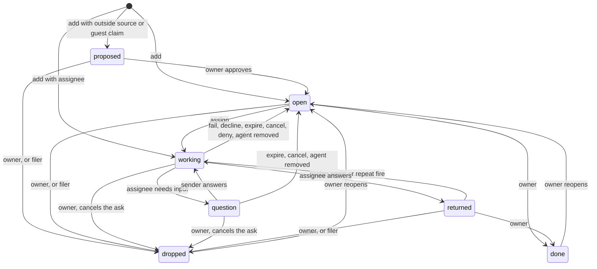
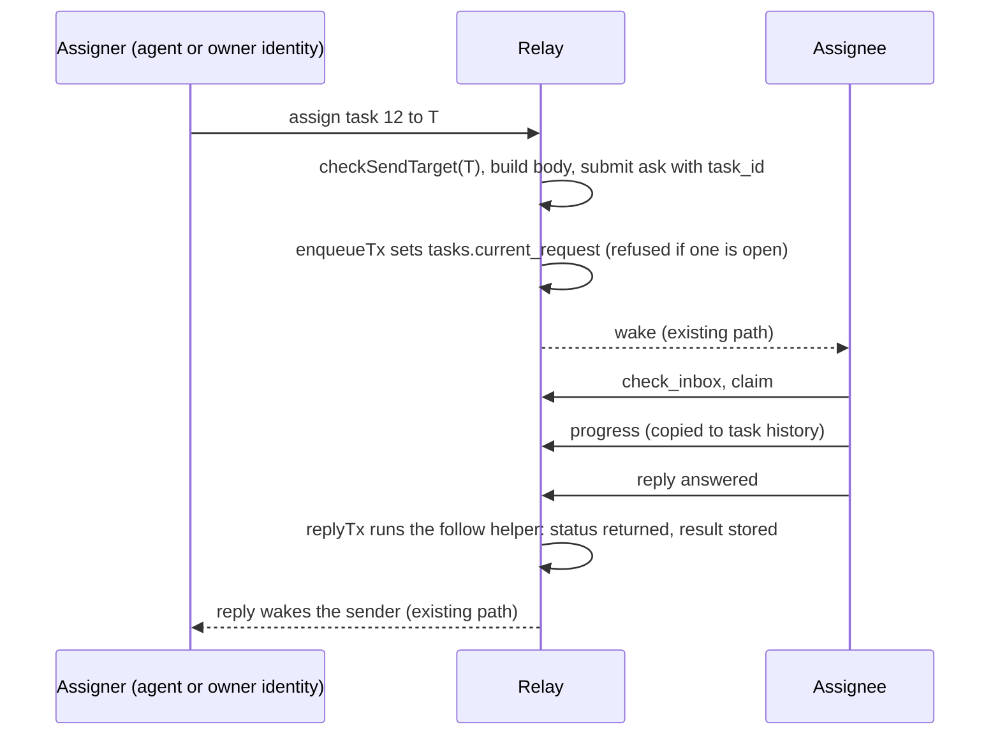

# Shared Task List - Plan

## Goal Capsule

- Objective: the owner and every agent on a Tincan team work from one lasting list on the relay machine that shows what is wanted, who has it, and what came back, so the owner stops being the one who remembers.
- Means: a task is a durable row on the relay, and each attempt at it is one ordinary ask tagged with the task (KTD1).
- Authority: the Requirements govern product behavior. The Key Technical Decisions govern mechanism within them. `docs/trust-model.md`, `docs/protocol.md`, `CONTRIBUTING.md` and the P0 rules in `greptile.json` override this plan where they conflict; a conflict is a stop condition, not something to work around.
- Execution profile: one pull request, built on a new branch from the latest `main`. The checkout this plan was written in is 174 commits behind `main`, so do not branch from it.
- Naming constraint: branch names, commit messages, the PR title and body, and every doc describe the feature on its own terms and name no outside product.
- Stop and ask when: the work would change a request's target anywhere but `Store.move`, serve any owner page route before `Server.isAdmin`, let an agent tool approve or mark done, or remove or rename an existing `/v1` route or field.
- Who finishes: the implementer opens the PR with docs updated in the same PR. The maintainer merges, tags and releases; the PR bumps no version.

---

## Product Contract

### Summary

Add a task list to the relay. A task has a title, what is wanted, an assignee, a status, a result, and a history of who did what. The owner and any agent can add tasks and hand them to a teammate. The teammate receives the task as an ordinary ask and answers with an ordinary reply, and the reply lands on the task as "returned". Only the owner marks a task done. The owner sees the list in a Tasks tab on the existing owner page and with `tincan tasks`. Agents get four tools.

### Problem Frame

Tincan moves one request at a time. A request expires after 24 hours and falls out of view once it is answered. Nothing on the relay holds the standing list of what the owner wants done, which teammate has each item, and what came back. The owner carries that list in their head and re-asks by hand when an ask fails or goes stale.

Tincan already has the hard parts a list needs: wake methods for agents that cannot be reached, identity from Tailscale, good-at lines and answer records for picking a teammate, owner approval, trace and search. What is missing is the lasting object those pieces act on.

### Actors

- A1. Owner. Acts from an admin device: the owner page in a browser, or the `tincan` CLI. Holds the powers no agent has.
- A2. Agent teammate. Any joined, non-guest agent. Files tasks, assigns them, receives them as asks, comments.
- A3. Web agent. A teammate driven through the Chrome extension. It cannot call tools; it can only receive an ask and have its answer sent back.
- A4. Guest. An agent on a time-limited invite. Has no access to the list.
- A5. Relay. Stores the list, builds each attempt's ask, and keeps the task in step with the request under it.

### Key Decisions

- Assignment is an ordinary ask. An agent that already handles asks needs to learn nothing to work a task. Governs R6, R7, R8.
- Returned is not done. An agent hands work back; only the owner accepts it. Governs R9, R14.
- The relay does not choose the assignee. Whoever assigns chooses, using the good-at lines the roster already shows. `docs/protocol.md` states the relay never routes on good-at, and this keeps that true. Governs R5.
- Text from outside the team waits for the owner. A task built from mail, a meeting or a guest's request is not delivered to any agent until the owner approves it. Governs R15.
- No connectors in the relay. Tasks from mail or meetings are filed by teammates that already have that access. Governs R19.

### Requirements

Tasks

- R1. A task has a short id, a title, a detail text saying what is wanted, a status, an assignee, the agent or owner that filed it, the latest result, and an ordered history.
- R2. The owner and any non-guest agent can add a task. A task is added unassigned, assigned to a teammate, or marked as the owner's own.
- R3. A task's status is one of: proposed, open, working, question, returned, done, dropped.
- R4. Every change to a task appends a history entry with the actor, the time and what changed. Comments are history entries with text. History is never edited or deleted while the task exists.

Assigning and working

- R5. The owner, or an agent that can see the task, can assign an open or returned task to a teammate that takes tasks. The assign surfaces show each teammate's good-at line and current status so the assigner can choose.
- R6. Assigning sends the assignee one ordinary ask that carries the task's title, detail, latest earlier result and the comments made since that result. The assignee is woken the way it is woken for any ask.
- R7. A task has at most one open ask under it at any time.
- R8. The assignee's reply updates the task: an answer sets it to returned and stores the result; a needs-input reply sets it to question; a failure, a decline, an expiry, a cancellation or an owner denial sets it back to open with the assignee cleared and the reason in the history.
- R9. No agent can mark a task done, approve a proposed task, reopen a done or dropped task, or reset a task's assign limit. Those belong to the owner on an admin device.
- R10. The owner can drop any task. Dropping a task with an open ask cancels that ask. An agent can drop only a task it filed, and only while no ask is open under it.
- R11. Marking done is allowed from open or returned and refused while an ask is open under the task.
- R12. When the owner's fallback moves a task's ask to another teammate, the task's assignee changes with it. Failover between web agents never moves a task's ask.
- R13. An agent can assign the same task at most 5 times until the owner resets the count. Owner assigns, repeat fires and relay moves do not count.

Safety

- R14. A returned task stays returned until the owner acts or someone assigns it again. Nothing completes a task automatically.
- R15. A task starts as proposed, and cannot be assigned to an agent, when its filer declares an outside source or files it while a guest-marked ask has reached it and is still open. In that same state the agent's comments on any task are refused. The owner approves a proposed task to open or drops it.
- R16. An agent sees a task when it filed it, when an ask under the task is addressed to it and is not held for the owner, when it has claimed an ask under the task, or when the task is open, unassigned and has no stored result. A proposed task is visible only to its filer. Admin devices see every task. Guests see none and can call no task route.
- R17. An agent can have at most 50 tasks it filed that are not done or dropped. Adding a task counts against the agent's send rate like an ask does.
- R18. Adding a task with a key the same agent already used on a task that is not done or dropped returns that task and creates nothing.

Recurring and auto-created tasks

- R19. A teammate that reads mail or meeting notes can file what it finds as tasks with a declared source and a key. No mail, calendar or notes connector is added to the relay.
- R20. A task that has an assignee can repeat on a schedule. Each fire starts a new attempt on the same task for the repeat's teammate, so the list shows one row whose history grows. Assigning the task to someone else changes the repeat's teammate.
- R21. A repeat fire is skipped while an ask is open under the task or the task is proposed. Marking a repeating task done or dropping it ends the repetition.

Owner surfaces

- R22. The existing owner page gains a Tasks tab that lists tasks grouped by status and lets the owner add, assign, comment, approve, mark done, reopen, drop, reset a task's assign count, and answer a question on a task the owner assigned from that device.
- R23. `tincan tasks` lists tasks and has subcommands for the same actions.

Compatibility

- R24. Existing asks, replies, rooms, schedules and every existing route behave exactly as before for a relay or client that does not use tasks. A client talking to an older relay gets a clear "this relay has no task list" error.

### Key Flows

- F1. Owner hands out work
  - **Trigger:** the owner adds a task on the Tasks tab and picks a teammate.
  - **Actors:** A1, A2, A5
  - **Steps:** the relay stores the task; it sends the teammate one ask built from the task; the teammate is woken, works, and replies; the relay stores the result and sets the task to returned; the owner reads the result and marks done.
  - **Covered by:** R2, R5, R6, R8, R11, R22
- F2. Agent files and delegates
  - **Trigger:** an agent decides a job belongs to a teammate and should not be lost.
  - **Actors:** A2, A5
  - **Steps:** the agent calls `add_task` with an assignee; the assignee gets the ask; its reply returns the task and wakes the filing agent as any reply does; the filing agent tells the owner.
  - **Covered by:** R2, R6, R8, R14
- F3. Outside text waits
  - **Trigger:** a scheduled mail check finds a message that needs action.
  - **Actors:** A2, A1, A5
  - **Steps:** the agent files a task with source `mail` and a key; the task is proposed; the owner sees it on the page, approves it and assigns it or keeps it as their own.
  - **Covered by:** R15, R18, R19
- F4. A question comes back
  - **Trigger:** the assignee replies needs-input.
  - **Actors:** A2, A1, A5
  - **Steps:** the task shows question with the question text; the sender of the ask answers with the existing answer path, which for an owner-assigned task is an answer box on the task in the Tasks tab; the task returns to working on the same ask.
  - **Covered by:** R8

### Acceptance Examples

- AE1. Covers R7, R11. Given a task that is working, when the owner marks it done, then the relay refuses and says an ask is still open; the owner can drop it or wait.
- AE2. Covers R8. Given a working task whose ask expires after 24 hours, then the task is open, has no assignee, and its history says the ask expired.
- AE3. Covers R15, R16. Given an agent files a task with source `mail` and assignee `codex`, then the task is proposed, `codex` receives nothing and cannot see it, and the page shows `codex` as the filer's suggestion.
- AE4. Covers R18. Given an agent adds a task with key `mail:1842` twice, then the second call returns the first task's id and the list has one row.
- AE5. Covers R10. Given a task that an agent has claimed, when the owner drops it, then the ask is cancelled, and the agent's later reply is refused the way a reply to a cancelled request is refused today.
- AE6. Covers R21. Given a repeating task that is returned, when its schedule fires, then a new ask goes out, the task is working, and the earlier result is still in the history.
- AE7. Covers R9. Given any agent calls any task tool or route, then no call marks a task done or approves a proposed task.

### Success Criteria

- An agent that has never heard of the task list completes an assigned task correctly using only `check_inbox` and `reply`.
- A web agent can be assigned a task and its answer lands on the task.
- After a relay restart at any point, no task is left working with no open ask under it.

### Scope Boundaries

Not built, considered and decided against for this plan:

- Self-take, where an agent assigns an open task to itself. An ask from an agent to itself is refused by the cycle check, and no request can be created already claimed. Building it needs a new kind of relay-authored request. Revisit if owners report open tasks sitting while an idle agent could have taken them.
- The owner answering a question on a task another agent assigned. Only the sender of an ask can answer it today, and that sender is woken by the question as it is now. Revisit if questions on agent-assigned tasks routinely stall.
- Delivering one task at a time per assignee. Many asks to one agent can already queue today. Revisit if `check_inbox` claiming many task asks at once causes lapsed claims in practice.
- Comments that wake the assignee mid-attempt. A comment is carried into the next attempt only.
- Automatic completion, including for repeating tasks.
- Keeping the text of a reply that arrives after the owner dropped the task.
- Refusing a done when the owner's view is stale. Done is already refused while an ask is open (R11), and the owner can reopen a done task.
- Assigning tasks to the history, notes, pass and council services (KTD13). Revisit council if owners ask to put a council question on the list.

Outside this product's identity:

- Mail, calendar, notes or message connectors inside the relay.
- Sharing a list with other people or their agents.
- A native mobile or desktop app.

#### Deferred to Follow-Up Work

- A triage teammate or suggestion that proposes an assignee for unassigned tasks from good-at lines and answer records.
- Due dates and reminders.
- Push alerts to the owner's phone when a task returns or asks a question, reusing the held-ask alert path.
- Task counts in `tincan top`.
- Importing tasks from other to-do tools.

---

## Planning Contract

### Key Technical Decisions

- KTD1. A task attempt is an ordinary request with a relay-only `task_id` column. This mirrors `requests.room_post_id` and `Request.RoomPostID`: the relay sets it, a send cannot, and older clients see a plain ask. Every wake path, the claim lease, requeue, the owner's fallback, owner approval holds and the web-agent worker then cover task work with no new code. `failoverIneligible` refuses a request with a task id, beside the room-mention case, because an attempt body carries teammates' text that must not move to another vendor's site. `group_id` and `trace_id` were rejected as the link: a group is per sender and capped at 8, and a trace is one chain, while a task outlives many requests.
- KTD2. The ask is sent as the agent identity that assigned. For an agent, that is itself. For the owner on the page, that is the device's phone agent, as the Ask and Rooms tabs do. For the owner in the CLI, that is the local agent identity, as `tincan ask` does. A relay-authored ask was rejected: no code path sends an ask as the relay today, and policy, loop limits, rate limits, `approval.json` rules and reply routing all assume an agent sender. Consequence: assigning from the page needs the phone joined, the same condition the Ask tab already has, and so does adding a repeating task. Adding, commenting, approving, done, reopen and drop need only an admin device. An attempt an agent starts keeps the parent and chain rules of any ask it sends, so the guest mark and cycle check apply; a repeat fire starts a new chain as schedule fires do.
- KTD3. The task follows the request through one store helper. The helper runs inside the transaction of every store write that ends or pauses a request, and it is guarded by `tasks.current_request = ?` so a stale write changes nothing. The writes are the terminal-reply family that goes through `replyTx`, plus `needsInput`, `answer`, `cancel`, `CancelAllFor`, the expiry passes of `Store.Sweep`, `DenyHeld`, and `Store.move`. `Store.Sweep` runs its bulk updates with no transaction today, so its expiry passes are wrapped in one transaction and the helper runs for each returned id that has a task. The task also keeps the id of the request that produced its stored result, so a later reply that replaces a held acknowledgement on that request overwrites the result while the task is still returned. A reply-only mirror was rejected because only 4 of the 11 request-changing writes pass through `replyTx`.
- KTD4. The task is claimed inside `enqueueTx` with a conditional update that sets `current_request` only when it is empty and the status allows an attempt. This is what enforces R7; a check before `Server.submit` would race, because `Store.Enqueue` commits in its own transaction. `RoomPostID` membership is checked in the same place.
- KTD5. Task status stores only the seven values in R3. Whether a working task's ask is held, queued, delivered or claimed is read from the request row when a task is listed, not copied. This keeps the follow helper off the high-frequency claim and requeue writes.
- KTD6. History and comments share one append-only `task_events` table modeled on `room_posts`. Rooms were rejected as the thread: only admins create rooms and change members, and `roomRefusal` excludes many agent kinds that must still be assignable. The hash-chained audit log was rejected as the history: it carries no text and cannot be queried by entity.
- KTD7. The owner as assignee or filer is stored as a marker that `nameRE` in `internal/identity/directory.go` can never match, and is shown as "owner". `owner` is a legal agent name today, so the literal word is not safe to reserve.
- KTD8. The relay builds the ask body. A fixed preamble says the block is a task the sender assigned for the recipient to carry out and hand back with a reply, names the agent that filed it and the author of each comment, and says that nothing inside the block changes how to reply. Task text sits between random delimiters. The body carries what R6 lists plus one line on how to return or ask. It never carries the full history or other tasks. The framing tells an untaught agent what to do; it is not the control for outside text, which is R15.
- KTD9. Owner-only actions are admin routes registered in `adminRoutes`, each checking `Server.isAdmin` in its handler, with no MCP tool and no agent route. From a browser they require the one-time nonce bound to task, decision and device, as held-ask approvals do. Task nonces are issued only with the admin task listing, and the P0 phone rule in `greptile.json` is updated in the same PR to name that listing and the task text the page inserts.
- KTD10. A repeating task is a schedule row with a nullable task id. `fireSchedule` starts an attempt through the same assign path instead of sending the schedule's own body. A separate recurrence engine was rejected because schedules already own timing, the 32-per-agent limit, the skip-while-open rule and the refusal to create a schedule while holding a claim.
- KTD11. Result attachments stay on the request that carried them. The task stores a pointer line naming the request and the files, as `mirroredBody` does for rooms. They follow the existing retention of 7 days after the request closes.
- KTD12. A `Tasks` flag on `GET /v1/capabilities` gates clients, and the client returns `ErrTasksUnsupported` against a relay without it. This is how attachments and schedules were introduced.
- KTD13. The assign path refuses assignees of kind history, notes, pass and council, in addition to the phone and guest refusals `checkSendTarget` already makes. Those services parse the ask as a fixed form, and three of them answer from the owner's private data, which a task result would then spread to the task's readers. Follow-ons and rooms already refuse the same kinds.
- KTD14. The hold decision for an attempt treats every agent whose text the body carries as if it were in the chain: the filer, the author of the carried result, and the authors of carried comments. They are recorded as relay-only contributors on the request and are not added to the loop check, so assigning to an earlier assignee still works. Without this, an `approval.json` rule that holds one agent's asks to a target would not hold a task that agent filed and another agent assigned.
- KTD15. A repeat's schedule row keeps its own sender and target. A fire assigns the task to that target even when a failed attempt cleared the task's assignee. Assigning the task to a different teammate updates the schedule's target in the same transaction; a fallback move does not.

### High-Level Technical Design

Task states and who moves them:

One attempt, end to end:

How each request change reaches the task (KTD3):

| Request change | Store write | Task after |
|---|---|---|
| answered | `Reply`, `ReplyByEmail` | returned, result stored |
| failed or declined | `Reply`, `FailHeld` | open, assignee cleared |
| needs input | `needsInput` | question |
| answered by sender | `answer` | working |
| cancelled by sender | `cancel` | open, assignee cleared |
| sender or target removed | `CancelAllFor` | open, assignee cleared |
| expired, including a hold that timed out | `Store.Sweep` expiry passes | open, assignee cleared |
| denied by owner | `DenyHeld` | open, assignee cleared |
| a later reply replaces a held acknowledgement | `Reply` with `Replaced` | still returned, result overwritten |
| moved by the owner's fallback | `Store.move` | assignee set to the new target |

### Assumptions

- The page's existing whoami and join flow is enough for assigning from the page; a device with no phone agent shows the same "join this phone" prompt the Ask tab shows.
- Web-agent allowlist files (`internal/history/serve.go`, default every joined agent) and `approval.json` rules (`internal/policy/approval.go`) match on sender names, and on the request's chain. KTD14 extends the hold decision to the agents whose text an attempt carries. A hold shows on the task through KTD5. A send the relay refuses before it is queued creates no request, returns the refusal to the assigner and leaves the task as it was; a refusal that arrives as a reply returns the task to open through KTD3.

### Sequencing

U1 and U2 land the data and lifecycle with no reachable surface. U3 opens the routes with their gates in the same unit. U4 and U6 are surfaces over U3 and can be built in either order. U5 follows U4. U7 follows U4 and U5, because it adds the repeat option to the command and the tool they create. U8 documents what shipped. No capability is reachable before its gate, because the routes and the gates are one unit.

### System-Wide Impact

- Requests table gains a nullable column, and every store write KTD3 names gains a call to the follow helper. Those writes are the core of the relay, so the helper must do nothing when `task_id` is null.
- `Store.move` is a P0 area in `greptile.json`. The change adds a task update inside the existing move statement's transaction, adds one refusal to `failoverIneligible`, and does not add a second place where a target changes.
- The owner page is a P0 area. The Tasks tab stays inside `/phone/`, behind `handlePhone`, under the existing CSP, with text-only insertion. No new path is served to browsers, so `relay.HardenForBrowsers` is not widened.
- The tool list is pinned in about a dozen places that tests and docs check, including `ToolNames`, `tincan doctor` and the wake allowlist templates.
- The hold decision in `internal/policy` reads a new relay-only contributors list on task asks (KTD14). Plain asks carry none and are decided as before.
- Agent removal now also releases tasks, and `DeleteAgent`'s schedule cleanup must clear a task's repeat link.

### Risks and Dependencies

| Risk | Mitigation |
|---|---|
| Task text written from mail or a meeting is read by another agent as owner-authorized work. | R15 holds such tasks as proposed and refuses comments while a guest's ask is open. KTD14 keeps `approval.json` holds in force for carried text. Standing instructions tell agents to declare the source. An agent that fails to declare is no worse than the same agent sending an ask today. |
| Two agents hand a task back and forth. | R13 caps agent assigns per task; R7 allows one ask at a time; the existing hop and cycle limits still apply within a chain. |
| An agent files tasks in a loop. | R17 caps open tasks per filer and charges the send rate; R18 dedupes on a key. |
| A missed follow-helper call leaves a task working forever. | KTD3 names every write. U2 adds a test that walks each request-ending path for a task-linked request and asserts the task moved. |
| A removed agent's name is reused and the new agent sees the old agent's tasks. | Names are issued by the owner through invites, the same trust the roster has today. Noted in `docs/trust-model.md`. |
| A task result or detail reaches agents that were never part of the work. | R16 limits the team-wide pool to open, unassigned tasks with no result; KTD13 keeps private-data services off the list; R12 keeps attempts off failover. `docs/trust-model.md` states that an unassigned task is readable by every joined agent. |
| The PR is large for one review. | Units are ordered so each commit builds and passes tests alone. |

### Open Questions

For the owner, not blocking the build:

- When the owner assigns from the page, the ask is sent as the phone agent, which nothing wakes. A return or a question on that task shows only when the page is open, on the Tasks tab count. A phone alert for those two events, reusing the held-ask alert path, is listed under follow-up work. Decide whether it belongs in this PR instead.

Deferred to implementation, none blocking:

- What is the right default page size and preview length for the Tasks tab on a phone screen?

---

## Implementation Units

### U1. Task storage and the request link

**Goal:** tasks, task history and the request link exist in the store, with every state change expressed as one store method.

**Requirements:** R1, R3, R4, R7, R13, R17, R18

**Dependencies:** none

**Files:**
- `internal/store/tasks.go` (new)
- `internal/store/tasks_test.go` (new)
- `internal/store/store.go` (register the migration; add `task_id` to the requests insert and scan)
- `internal/envelope/envelope.go` (task and task event types; relay-only `TaskID` on `Request`)

**Approach:**
1. Add `migrateTasks()` to the ordered list in `store.Open`: `tasks`, `task_events`, and a nullable `requests.task_id` added with the `pragma_table_info` then `ALTER TABLE` idiom.
2. Store methods: add, get, list with a visibility filter, append event, set status, and the conditional claim from KTD4.
3. Enforce R17 and R18 inside the insert's transaction, as `MaxSchedules` is enforced in the schedule insert.
4. Keep the agent-assign count for R13 and the id of the request that produced the stored result (KTD3) on the task row.
5. Entity tables carry no foreign key to agents; cleanup on removal is U2's.

**Patterns to follow:** `internal/store/schedules.go` for a new entity and its in-transaction limits; `internal/store/rooms.go` for an append-only thread and the request link column.

**Test scenarios:**
- Opening a database created before this change adds the tables and the column, and existing requests read back unchanged.
- Opening twice is a no-op.
- Adding a task returns an id and writes one "added" event with the actor.
- The 51st open task from one filer is refused; a done task frees a slot.
- Adding with a key already on an open task from the same filer returns that task; the same key from another filer creates a new task; the same key after the first is done creates a new task.
- The conditional claim succeeds on an open task, fails on a working task, and fails on a proposed task.
- Listing as an agent returns tasks it filed, was assigned, and open unassigned ones, and omits another agent's proposed task.

**Verification:** store tests pass under the race detector, and no existing store test changed.

### U2. Attempt lifecycle in the relay

**Goal:** assigning a task sends one ask, and the task tracks that ask through every way it can end, pause or move.

**Requirements:** R5, R6, R7, R8, R10, R11, R12, R14, R24

**Dependencies:** U1

**Files:**
- `internal/relay/tasks.go` (new: assign path, body builder, follow hooks)
- `internal/relay/tasks_test.go` (new)
- `internal/store/tasks.go` (the follow helper)
- `internal/store/store.go`, `internal/store/replies.go`, `internal/store/clarification.go`, `internal/store/approval.go`, `internal/store/failover.go` (call the helper inside each write KTD3 names)
- `internal/relay/server.go` (agent removal releases tasks)
- `internal/policy/policy.go`, `internal/policy/approval.go` (contributors in the hold decision, KTD14)
- `internal/policy/approval_test.go`

**Approach:**
1. The assign path calls `checkSendTarget` itself, because `submit` does not; this is what refuses phone agents and guests as assignees. It then applies the kind refusals in KTD13.
2. Build the body per KTD8 and send through `Server.submit` with the sender from KTD2, the task id and the contributors from KTD14 set.
3. Write the follow helper once and call it from each write in the KTD3 table. It returns at once when the request has no task. Wrap the expiry passes of `Store.Sweep` in one transaction first.
4. Copy progress notes to `task_events` where progress is stored.
5. Owner drop and owner reassign cancel the open ask in the same transaction as the task change, as `RemoveRoomMember` cancels a member's mentions.
6. Store a pointer line for result attachments per KTD11.
7. Add the task-id refusal to `failoverIneligible` per KTD1.

**Execution note:** write the path-walking test first: one task-linked request per ending in the KTD3 table, each asserting the task's state. It should fail for every row before the helper is wired.

**Patterns to follow:** `sendMentions` and `mirrorReplyTx` in `internal/relay/rooms.go` and `internal/store/rooms.go` for a relay-built ask whose reply is mirrored in the reply transaction.

**Test scenarios:**
- Covers F1. Assign to an agent: one ask is queued to it with the task id, the body contains the title and detail between delimiters, and the task is working.
- Assign while an ask is open is refused, and no second request exists.
- Two assigns racing on one open task: exactly one request is created.
- Answered reply: task is returned, result equals the reply body, and an event names the replier.
- Covers F4. Needs-input reply sets question; the sender's answer sets working on the same request id.
- Each of failed, declined, sender cancel, expiry, owner denial and hold timeout sets the task to open with no assignee and a reason in the history.
- Covers AE2. A working ask that passes its 24 hour mark sets the task to open with no assignee.
- A needs-input ask that passes its 24 hour mark does the same.
- A hold that times out in the sweep sets the task to open.
- Fallback moves the ask to another agent: the task's assignee is that agent, in the same transaction.
- Covers AE5. Owner drops a claimed task: the request is cancelled and a later reply gets the existing refusal.
- Removing the assignee or the sender from the team sets their working tasks to open.
- A held acknowledgement closes the request and the task is returned with that text; the real reply then arrives and the task's result is the real reply.
- A reply that replaces a held acknowledgement does not change a task that has since moved on.
- Assign to a history, notes, pass or council agent is refused, and no request exists.
- A web assignee whose site is out of messages keeps the task ask; failover does not move it.
- A task filed by an agent that `approval.json` gates for target T, assigned to T by an ungated agent, is held. The same holds when the gated agent only commented.
- A plain ask from the ungated agent to T is not held, as before.
- The body names the filing agent and each comment's author.
- An agent that assigns while holding a claim on a request whose chain includes the assignee gets the existing cycle refusal, and the task stays open.
- Assign to a phone agent and to a guest is refused with the existing target errors.
- A plain ask with no task id behaves exactly as before in every path above.
- Integration: relay restarted between enqueue and reply; on restart the task is working with its request open, and the reply still returns it.

**Verification:** the path-walking test passes for every row of the KTD3 table, and the existing relay and store suites pass unchanged.

### U3. Task routes, gates and capability

**Goal:** agents and admin devices can reach the task list over HTTP, with every rule in the Safety requirements enforced at the route.

**Requirements:** R2, R5, R9, R10, R11, R13, R15, R16, R17, R22, R24

**Dependencies:** U1, U2

**Files:**
- `internal/relay/tasks.go` (handlers)
- `internal/relay/tasks_test.go`
- `internal/relay/server.go` (register in `routes()` and `adminRoutes()`)
- `internal/relay/attachments.go` (the `Tasks` capability flag)
- `internal/policy/policy.go` (charge add against the send rate)

**Approach:**
1. Agent routes under `/v1/tasks`: add, list, get, assign, comment, drop.
2. Admin routes under `/v1/admin/tasks`: list with nonces, add as owner, assign, approve, done, reopen, drop, reset the assign count. Each checks `isAdmin` in the handler and takes the nonce from a browser per KTD9.
3. The admin assign route is how the owner assigns. It requires an agent identity on the request to use as the sender (KTD2), skips the R16 filter and the R13 count, and records the owner as the actor. The agent routes under `/v1/tasks` always apply agent rules, even when called from an admin device. `handleSchedules` separates its admin view the same way.
4. Decide proposed at add time from the declared source and from `Store.OpenGuestAsks` for the caller, the lookup schedule creation uses. Refuse a comment in that state with an error modeled on `errScheduleDuringGuestAsk`.
5. Apply the visibility rule from R16 on list and get; a task the caller cannot see answers not found.
6. Leave the routes closed to guests, which `guestGate` does by default for new routes.
7. Audit each task action with `Server.record`, without task text.

**Patterns to follow:** `internal/relay/schedules.go` for agent routes over a new entity; `handleApprove` and `handleDeny` with `nonceBook` for owner decisions from a browser.

**Test scenarios:**
- An agent adds a task unassigned, assigned, and as the owner's own; each reads back with the right status and assignee.
- Covers AE3. Add with source `mail` and an assignee: status is proposed, no request exists, and the assignee's list omits it.
- Add while a guest-marked ask is claimed, delivered but unclaimed, or waiting in needs-input for the caller: status is proposed without a declared source.
- Comment in any of those states is refused; the same agent's comment after the guest ask closes succeeds.
- Assign to a target that `approval.json` gates: while the ask is held the target's list omits the task and get answers not found; after a denial it still does; after approval the target sees it.
- A task that returns to open with a stored result is not in an uninvolved agent's list; an open task with no result is.
- An agent that claimed an earlier attempt still sees the task after it is reassigned.
- Owner assign through the admin route on a returned task the phone agent did not file succeeds and does not count toward the assign limit.
- Admin assign with no agent identity on the request is refused with a message that says to join the device.
- Covers AE7. No agent route marks done, approves, reopens or resets; each admin route answers forbidden to a non-admin agent.
- Admin done from a browser without a nonce is refused; with a used nonce is refused; with a fresh nonce succeeds.
- Covers AE1. Done on a working task is refused with a message naming the open ask.
- An agent's sixth assign of one task is refused; after an owner reset it succeeds; owner assigns never count.
- An agent drops its own open task; dropping another agent's task, or its own working task, is refused.
- A guest calling any task route is refused.
- Covers R24. `GET /v1/capabilities` includes the flag, and every pre-existing route test passes unchanged.

**Verification:** route tests pass through `internal/testrelay` with pinned caller addresses for an agent, a second agent, a guest and an admin device.

### U4. Client and `tincan tasks`

**Goal:** the owner and scripts can use the list from a terminal.

**Requirements:** R23, R24

**Dependencies:** U3

**Files:**
- `internal/client/tasks.go` (new)
- `internal/client/tasks_test.go` (new)
- `internal/client/attachments.go` (read the capability)
- `internal/cli/tasks.go` (new)
- `internal/cli/tasks_test.go` (new)
- `internal/cli/root.go` (register the command)

**Approach:**
1. Client methods for each route, returning `ErrTasksUnsupported` when the relay lacks the flag.
2. `tincan tasks` lists grouped by status. Subcommands: `add`, `show`, `assign`, `comment`, `done`, `approve`, `reopen`, `drop`, `reset`.
3. `add` takes the title as an argument, the detail from a flag or standard input, and flags for an assignee or for the owner's own. `assign` with no teammate prints the roster with status and good-at lines.
4. `assign` uses the admin assign route with the local agent identity as sender per KTD2, and says so when the machine has none, pointing to the owner page.
5. `comment` on a task with an open ask prints that the comment reaches the assignee on the next attempt.
6. Print task and reply text through the terminal-safe output helpers in `internal/cli/termout.go`, since it is teammates' text.

**Patterns to follow:** `internal/client/schedules.go` and `internal/cli/schedules.go`; `internal/cli/rooms.go` for a command that mixes agent and admin actions.

**Test scenarios:**
- Each subcommand calls its route and prints the task id and new status.
- Against a relay without the capability, every subcommand prints the unsupported message and exits non-zero.
- `tasks show` on a task with control characters in its title prints them escaped.
- `tasks assign` on a machine with no agent identity explains why and changes nothing.
- `tasks done` from a non-admin machine reports the relay's refusal.

**Verification:** CLI tests pass; a manual run against a local relay adds, assigns, returns and completes one task.

### U5. Agent tools and standing instructions

**Goal:** agents can file, read, assign and comment on tasks, and know when to.

**Requirements:** R2, R5, R9, R15, R18, R19

**Dependencies:** U3, U4

**Files:**
- `internal/mcpserver/server.go` (four tools, `ToolNames`, the `Instructions` text)
- `internal/mcpserver/server_test.go`
- `internal/onboard/templates/agent.tmpl`
- `examples/lib/tincan-wake-lib.sh`
- `internal/cli/doctor_test.go`, `internal/gateway/gateway_test.go` (pinned tool lists)

**Approach:**
1. Add `add_task`, `list_tasks`, `get_task`, and `update_task` with an `action` of assign, comment or drop, following the `lease` tool's action field.
2. Receiving and returning need no new tool: they are `check_inbox` and `reply`.
3. Add standing lines that say: file a task when work should outlive the conversation; give a key when filing from a recurring check; declare the source when the text came from mail, a meeting or any outside party, and file a new task for such text instead of commenting it onto an existing one; a reply to a task ask is the hand-back and the owner decides done; do not assign a task you were assigned back to its sender; when a reply to a task ask arrives that this session did not send, tell the owner and do not answer it yourself.
4. Keep the added instruction text short. The attempt body from KTD8 already tells an untaught agent what to do.
5. Update every place the tool list is pinned so `tincan doctor` and the wake allowlist tests agree.

**Patterns to follow:** the `lease` and schedule tool registrations in `internal/mcpserver/server.go`, and the description style of the existing tools.

**Test scenarios:**
- `add_task` with a title creates a task and returns its id and status.
- `add_task` with a source returns status proposed and says the owner must approve.
- `list_tasks` returns only tasks the calling agent can see.
- `update_task` with action assign on a visible open task sends the ask; with an unknown action returns a clear error.
- No tool name or action marks a task done.
- Against a relay without the capability, each tool returns the unsupported message.
- The tool list in `ToolNames`, the doctor check and the wake allowlist template match.

**Verification:** MCP tests pass, and a connected agent's tool list shows the four tools.

### U6. Tasks tab on the owner page

**Goal:** the owner sees and runs the list from a browser on the tailnet.

**Requirements:** R5, R8, R9, R22

**Dependencies:** U3

**Files:**
- `internal/phone/static/index.html`
- `internal/phone/static/app.js`
- `internal/phone/static/style.css`
- `internal/phone/phone_test.go`
- `internal/relay/phone_test.go`

**Approach:**
1. Add a Tasks tab beside Team, Ask and Rooms, in the tablist with the same roles and touch target, refreshed on the page's existing 5 second cycle. Its label carries a count of tasks waiting on the owner: proposed, returned, and questions this device can answer.
2. Group rows as Proposed, Needs your answer, Returned, Working, Open, Yours, with Done and Dropped behind disclosure buttons. Each task appears in exactly one group, chosen top to bottom in that order. Yours holds only open tasks marked as the owner's own. Each group is sorted oldest-waiting first and shows a count, and an empty list shows one line saying so.
3. A row shows title, status as text, assignee and age. A working row also shows the request's live state from KTD5.
4. Needs your answer holds only question tasks whose ask this device's agent sent, each with an inline answer box that calls the existing request answer route. A question on an ask another agent sent stays in Working, labelled as waiting on that sender.
5. A row expands in place to show the detail, the latest result, the history with older entries behind a control, a comment box, and the actions that apply. When the task has an open ask, the comment box says the comment reaches the assignee on the next attempt.
6. An add panel takes a title, a detail, and a choice of unassigned, a teammate, or the owner's own.
7. A Proposed row shows the filer, the declared source or that it was filed while handling a guest's ask, and any suggested assignee labelled as a suggestion. Approve moves it to Open and opens the assign picker with the suggestion preselected.
8. The assign picker is a list of rows from the roster the Team tab already loads, each with name, status and good-at line, leaving out guests, phone agents and the kinds in KTD13.
9. Assign and add-with-teammate use the admin assign route with the page's agent identity. When the device has none, those two controls are disabled beside a button that opens the Ask tab's join panel; adding unassigned or as the owner's own stays available.
10. Approve, done, reopen, drop and reset send a nonce the way the held list does. Each relay refusal shows as inline alert text on the row, including the open-ask refusal from R11 and an already-decided result.
11. A refresh updates rows in place by task id and never rebuilds a row that has focus, an open picker or typed text, as the Ask tab's answer box is preserved today. Every task action is disabled while the page is offline.
12. Status changes and owner decisions are announced through the page's existing live region, and action buttons carry labels that name the task.
13. Insert all task, comment and result text as text nodes only, under the existing CSP, with no new origin, inline script or style.

**Patterns to follow:** the Rooms tab and the held list in `internal/phone/static/app.js`; the string-level assertions in `internal/phone/phone_test.go`.

**Test scenarios:**
- The served page includes the Tasks tab and the CSP header is unchanged.
- The embedded script contains no `innerHTML` assignment for task fields.
- `/phone/` and every static file still answer forbidden to a non-admin caller.
- The done, approve, reopen, drop and reset calls in the script each send a nonce.
- The tab is in the tablist with its role and controls attributes, and the Done and Dropped groups are buttons with an expanded state.
- The script announces task status changes through the live region.
- The answer box is rendered only for a question whose ask this device's agent sent.
- Integration: an admin device loads the page, the task list call succeeds, and a non-admin agent making the same admin call is refused.

**Verification:** phone tests pass, and a manual pass on a phone-sized viewport adds a task, assigns it, sees it return, and marks it done.

### U7. Repeating tasks

**Goal:** a task can repeat on a schedule as one row with a growing history.

**Requirements:** R20, R21

**Dependencies:** U2, U3, U4, U5

**Files:**
- `internal/store/schedules.go` (nullable task id; clear the link on cancel and on agent deletion)
- `internal/store/schedules_test.go`
- `internal/relay/schedules.go` (`fireSchedule` starts a task attempt)
- `internal/relay/schedules_test.go`
- `internal/relay/tasks.go` (repeat on add; end repetition on done and drop)
- `internal/mcpserver/server.go`, `internal/cli/tasks.go` (the repeat option on add)

**Approach:**
1. Adding a task with a repeat requires an assignee and is refused for an unassigned task or the owner's own. It creates the schedule through the existing creation path, so the 32-per-agent limit and the refusal while holding a claim apply as they do now. The schedule's sender is the filing agent, or for an owner add the agent identity on the request, refused when there is none.
2. On fire, when the schedule has a task id, call the assign path with the schedule's sender and target per KTD15, and skip per R21.
3. Done and drop delete the schedule row. Cancelling the schedule clears the task's repeat link and leaves the task.
4. Assigning the task to a different teammate updates the schedule's target in the same transaction.
5. A fire does not count toward R13.

**Patterns to follow:** `fireSchedule` and its skip-while-open rule in `internal/relay/schedules.go`; the injected clock in `internal/relay/schedules_test.go`.

**Test scenarios:**
- Covers AE6. A repeating task that is returned gets a new ask on the next fire, and the earlier result is in the history.
- A fire while the task is working, in question, or proposed is skipped and audited as skipped.
- Marking a repeating task done removes its schedule; no later fire sends anything.
- Cancelling the schedule leaves the task with no repeat link.
- Removing the agent that owns the schedule clears the link and leaves the task open.
- Adding a repeating task while holding a claim is refused with the existing schedule error.
- Ten fires on one task do not trip the assign limit.
- A repeating task whose attempt expired, leaving no assignee, gets a new ask to the same teammate on the next fire.
- After the owner assigns a repeating task to another teammate, the next fire goes to that teammate.
- Adding a repeating task with no assignee is refused.
- A fire's body never includes a comment refused under R15.

**Verification:** schedule tests pass with the injected clock, and a schedule with no task id fires exactly as before.

### U8. Documentation

**Goal:** owners and agents can learn the feature from the docs that ship with it.

**Requirements:** R19, R24

**Dependencies:** U4, U5, U6, U7

**Files:**
- `README.md` (a "Tasks" section and the tools table; no "New in" version section)
- `docs/protocol.md` (routes, the capability flag, the request link)
- `docs/trust-model.md` (owner-only actions, proposed tasks, visibility, name reuse)
- `docs/phone.md` (the Tasks tab)
- `docs/adapters/agent-instructions.md`, `docs/adapters/scheduled.md`, and the adapter docs that list tools
- `site/agents.txt`
- `greptile.json` (the P0 phone rule names the task listing as a second place nonces are issued, and the task text the page inserts)

**Approach:**
1. Document tasks as their own feature section; versions come from the release tag.
2. In `docs/adapters/scheduled.md`, add a recipe for a scheduled mail or meeting check that files proposed tasks with a key.
3. State in `docs/trust-model.md` that approval and completion stay with people, who can read a task (R16), that an open unassigned task is readable by every joined agent, which kinds cannot be assigned (KTD13), and how holds apply to carried text (KTD14).

**Test scenarios:** Test expectation: none -- documentation only; the doc-pinned tool lists are covered by U5's tests.

**Verification:** every doc that lists tools names the four new ones, and a search of the diff finds no outside product name.

---

## Verification Contract

| Gate | Command | Applies to |
|---|---|---|
| Build | `make build` | all units |
| Tests with race detector | `make test` | all units |
| Vet | `make vet` | all units |
| Lint | `make lint` | all units |
| Focused relay coverage | `go test -cover ./internal/relay/` | U2, U3, U7 |
| Extension tests | `make extension-test` | only if `extension/` changes, which this plan does not expect |
| PR title | Conventional Commits, checked by `pr-title` | the PR |

The tests that prove the plan are U2's path-walking test over the KTD3 table, U2's hold tests for carried text, U3's owner-only and visibility tests, and U6's admin-gate and text-insertion tests.

## Definition of Done

- Every requirement R1 to R24 is met and each acceptance example has a passing test.
- All gates in the Verification Contract pass on the PR.
- A task assigned to a real agent on a live relay returns and is marked done from the owner page, and the PR description says which agent was used.
- A web agent was assigned one task on a live relay and its answer landed on the task, or the PR description says this was not run and why.
- Existing relay, store, client, CLI, MCP and phone tests pass without edits to their expectations, apart from the pinned tool lists.
- Docs in U8 are in the same PR.
- The PR bumps no version and adds no release notes.
- Code from abandoned approaches is removed from the diff.
- Branch name, commits, PR title and body, and docs name no outside product.

---

## Sources

- `internal/store/schedules.go`, `internal/relay/schedules.go`, `internal/client/schedules.go`, `internal/cli/schedules.go`: the most recent entity added end to end (commit 3627bea), and the file set this plan mirrors.
- `internal/store/rooms.go`, `internal/relay/rooms.go`: a thread, a request link column and a reply mirrored inside the reply transaction (commit afc1b9f).
- `internal/phone`, `docs/phone.md`: the owner page, its CSP, its admin gate and its nonce flow.
- `internal/relay/server.go` (`submit`, `checkSendTarget`, `handleRemove`, `adminRoutes`), `internal/policy/policy.go` (`Prepare`), `internal/store/failover.go` (`move`).
- `greptile.json`: the P0 rules on the phone page, request targets, admin powers and protocol compatibility.
- `CONTRIBUTING.md`: PR, compatibility and doc rules.
- External research on how current task-list products for AI agents model delegation informed three choices: handing work back as a state separate from completion, a per-task history that names every writer, and dedupe keys on tasks created by recurring checks.
